# eegproc

[中文](README.zh-CN.md) · **0.4.0a1** · [GitHub](https://github.com/LeiGuo0812/eegproc)

EEG preprocessing with MNE Raw input, native ASR, ICLabel-assisted ICA, reversible component review, event-level quality control, and a self-contained HTML report. Python parameters are the primary interface; JSON and the command line are optional adapters.

## Install

Use **Python 3.12** for the complete feature set. Install from GitHub in an activated virtual environment:

```bash
python -m pip install "eegproc @ git+https://github.com/LeiGuo0812/eegproc.git"
```

Or download/clone this repository, enter its root directory, and run:

```bash
python -m pip install -r requirements.txt
# All optional runtime backends:
python -m pip install -r requirements-all.txt
```

The distribution and import name are both `eegproc`. MATLAB is not required. The commands above install from GitHub/source; they do not assume a PyPI release. See the [installation tutorial](docs/en/installation.md) for Windows, Linux, macOS, optional dependencies, pinned revisions, and verification.

## First run

```python
import mne
from eegproc import run

raw = mne.io.read_raw_fif("prepared/sub01_raw.fif", preload=False)
result = run(
    raw,
    save_path="outputs/sub01_rest",
    subject="sub01",
    purpose="rest",
    task_name="eyes_closed",
)
print(result.status)
print(result.outputs["quality_report"])
clean_raw = result.raw
```

Prepare correct SI units, channel types, electrode locations, and event timing before processing. `purpose` selects analysis defaults; `task_name` records the task label. Original manual BAD annotations and auxiliary channels are retained. Inspect the report before accepting a recording for analysis.

| Default | Rest | ERP |
|---|---|---|
| Analysis band | 0.5–80 Hz | 0.1–30 Hz |
| ICA training band | 1–100 Hz | 1–100 Hz |
| ASR | Enabled; cutoff 20 | Enabled; cutoff 20 |
| ICA | Picard; ICLabel threshold rule | Picard; ICLabel threshold rule |
| Epoch export | Only when requested | Only when requested |
| Report waveform window | 4 s | 4 s |

`preset="eeglab"` changes parameters within the same workflow. It approximates the original EEGLAB script in Python; it is not numerical MATLAB reproduction. All settings are listed in the [parameter reference](docs/en/parameters.md).

## Workflow and files

```mermaid
flowchart LR
    A[Device data] --> B[Separate preparation]
    B --> C[MNE Raw]
    C --> D[Line noise and channels]
    D --> E[Reference, filters and ASR]
    E --> F[ICA fit and pre-subtraction checkpoint]
    F --> G[Automatic or manual IC selection]
    G --> H[Reconstruction and continuous QC]
    H --> I[Optional epoch QC]
    I --> J[Clean FIF, ICA and HTML]
    F --> K[HTML review]
    K -->|Resume without refitting| G
```



```text
outputs/sub01_rest/
├── sub01_cont_raw.fif
├── sub01-ica.fif
├── sub01_report.html
└── sub01_ica_review/
    ├── pre_ica_raw.fif
    ├── decomposition-ica.fif
    └── checkpoint.json
```

Requested epochs add `sub01_clean-epo.fif` when at least one trial survives. Figures and tables are embedded in the HTML. Each ICA run retains the pre-subtraction checkpoint, so a revised IC list can restore previously removed components without repeating filtering, ASR, or ICA fitting. See [ICA review and continuation](docs/en/usage.md#ica-review-and-continuation).

## Documentation

| Topic | English | 中文 |
|---|---|---|
| Installation and verification | [Installation](docs/en/installation.md) | [安装教程](docs/zh-CN/installation.md) |
| Preparation, rest, ERP, batch, ICA review, CLI | [Complete usage](docs/en/usage.md) | [完整使用示例](docs/zh-CN/usage.md) |
| Every parameter and its dependencies | [Parameters](docs/en/parameters.md) | [参数说明](docs/zh-CN/parameters.md) |
| Report, outputs, BAD labels and decisions | [Interpreting results](docs/en/results.md) | [结果解读](docs/zh-CN/results.md) |
| PSD, ERP, time-frequency, connectivity and statistics | [Further analysis](docs/en/analysis.md) | [后续分析建议](docs/zh-CN/analysis.md) |

[Executable examples](examples) · [Architecture](docs/ARCHITECTURE.md) · [Release audit](docs/RELEASE_AUDIT.md) · [Third-party notices](docs/THIRD_PARTY_NOTICES.md)

Run a complete synthetic example without downloading a dataset:

```bash
python examples/synthetic_demo.py --output outputs/demo
```

This exercises rest, ERP, ICA review, continuation and report rebuilding. [Example figures and their interpretation](docs/en/results.md#synthetic-example) are included in the guide. They demonstrate software use, not comparative denoising accuracy.

This alpha research package is released under the [BSD 3-Clause license](LICENSE), with separately retained [third-party terms](docs/THIRD_PARTY_NOTICES.md). Validation evidence is recorded in the release audit. Preserve each run's effective settings, software versions, prepared input, and ICA checkpoint.
