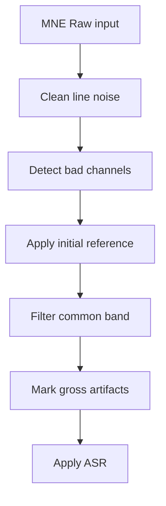
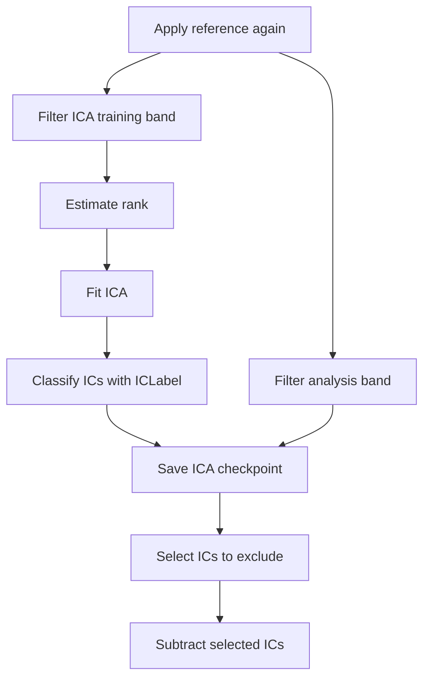
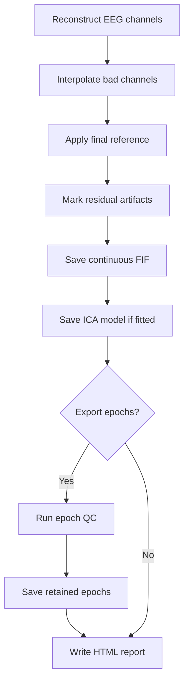

# eegproc

[中文](README.zh-CN.md) · [GitHub](https://github.com/LeiGuo0812/eegproc)

eegproc preprocesses resting-state and task EEG through MNE. It accepts continuous Raw data and combines line-noise removal, bad-channel detection, ASR, ICLabel-assisted ICA, and continuous or event-level quality control. Results include MNE FIF data and a self-contained HTML report with editable ICA selections.

Configure the workflow directly in Python, or use JSON and the command line. Every ICA run keeps a checkpoint for revising component exclusions without repeating the decomposition.

## Installation

Use **Python 3.12** and an activated virtual environment:

```bash
python -m pip install "eegproc @ git+https://github.com/LeiGuo0812/eegproc.git"
```

From a downloaded or cloned repository, run `python -m pip install -r requirements.txt` in its root directory. `requirements-all.txt` adds all optional runtime backends. See [installation](docs/en/installation.md) for Windows, Linux, macOS and dependency options.

## Quick start

```python
import mne
from eegproc import run

raw = mne.io.read_raw_fif("prepared/sub01_raw.fif", preload=False)
result = run(
    raw, save_path="outputs/sub01_rest", subject="sub01",
    purpose="rest", task_name="eyes_closed",
)
clean_raw = result.raw
print(result.status, result.outputs["quality_report"])
```

Prepare EEG/EOG/ECG in volts, electrode coordinates in metres, and correct channel types, montage and event timing. Device conversion is handled separately by `eegproc.preparation.prepare_data`. The input Raw is not modified; original BAD annotations and auxiliary samples are retained.

For a task recording with stimulus annotations `"1"` and `"2"`:

```python
task_raw = mne.io.read_raw_fif("prepared/sub01_task_raw.fif", preload=False)
events, _ = mne.events_from_annotations(task_raw, event_id={"1": 1, "2": 2})
erp = run(
    task_raw, "outputs/sub01_oddball", "sub01",
    purpose="erp", task_name="oddball",
    events=events, event_id={"standard": 1, "target": 2},
    epoch_tmin=-0.2, epoch_tmax=1.0,
)
```

`purpose` selects analysis defaults; `task_name` labels the recording. Supplying events requests event epochs. Inspect the HTML report and condition retention before accepting the data for analysis. Use a fresh output directory for each run.

| Standard default | Rest | ERP |
|---|---|---|
| Analysis band | 0.5–80 Hz | 0.1–30 Hz |
| ICA training band | 1–100 Hz | 1–100 Hz |
| ASR | Enabled; cutoff 20 | Enabled; cutoff 20 |
| ICA / automatic selection | Picard / ICLabel thresholds | Picard / ICLabel thresholds |
| Epoch export | When requested | When requested |
| Report waveform window | 4 s | 4 s |

## Parallel processing

Independent recordings can run concurrently in separate processes. `max_workers` selects the number of recordings processed at once; `n_threads` limits supported numerical-library thread pools within a recording and does not start batch workers. The included CSV batch example runs sequentially.

Save this as `parallel_preprocess.py` and run `python parallel_preprocess.py` from a terminal:

```python
import os

# Set these before importing NumPy, MNE or PyTorch.
for name in ("OMP_NUM_THREADS", "OPENBLAS_NUM_THREADS", "MKL_NUM_THREADS"):
    os.environ[name] = "1"

from concurrent.futures import ProcessPoolExecutor
from multiprocessing import get_context
from pathlib import Path


def process_one(job):
    recording_id, input_fif = job
    import mne
    from eegproc import run

    with mne.io.read_raw_fif(input_fif, preload=False, verbose=False) as raw:
        result = run(
            raw, Path("outputs_parallel") / recording_id, recording_id,
            purpose="rest", task_name="eyes_closed", n_threads=1,
        )
        return (recording_id, result.status, result.report.get("report_status"),
                result.outputs["quality_report"])


if __name__ == "__main__":
    jobs = [
        ("sub01_rest", "prepared/sub01_raw.fif"),
        ("sub02_rest", "prepared/sub02_raw.fif"),
    ]
    with ProcessPoolExecutor(max_workers=2, mp_context=get_context("spawn")) as pool:
        for recording_id, status, report_status, html in pool.map(process_one, jobs):
            print(f"{recording_id}: {status}; report={report_status}; {html}")
```

Keep the worker at module level and retain the `__main__` guard; run this example as a `.py` file rather than directly in a notebook cell ([Python process-pool requirements](https://docs.python.org/3/library/concurrent.futures.html#concurrent.futures.ProcessPoolExecutor)). Each `recording_id` must be unique and each recording needs its own **new output directory**, including separate tasks or sessions from the same participant. Pass paths to workers and return small summaries, rather than transferring Raw data or PipelineResult objects between processes.

Start with two workers and `n_threads=1`, then increase workers only when memory permits: each process still loads the recording and processing buffers. The environment settings reduce nested numerical threading; `n_threads` is not a strict limit on every thread in the process. Use process isolation for concurrent pipeline runs because plotting and logging have process-wide state. For ERP, set `purpose="erp"`, the appropriate `task_name`, and supply each recording's events inside its worker, as in the task example above.

## Workflow and outputs

### 1. Signal preparation



### 2. ICA decomposition



### 3. Reconstruction and outputs



ICA and interpolation steps follow the selected settings. The [detailed workflow](docs/en/workflow.md) includes optional paths, ECG support and manual ICA continuation.

Output from the quick-start example above:

```text
outputs/sub01_rest/
├── sub01_cont_raw.fif          Cleaned continuous data
├── sub01-ica.fif               ICA model and final exclusions
├── sub01_report.html           Figures, QC, settings and provenance
└── sub01_ica_review/
    ├── pre_ica_raw.fif         Data before component subtraction
    ├── decomposition-ica.fif   Frozen ICA decomposition
    └── checkpoint.json        Continuation state
```

Requested epochs add `sub01_clean-epo.fif` when trials remain. Report figures and tables are embedded in the HTML. Continuous BAD annotations mark problematic intervals without deleting samples.

To review before subtraction, set `ica_mode="review"`. To revise an automatic result, open its report and change **Exclude** on an IC tile or its detail view. Download the selection and call `resume()` with the checkpoint. A new complete list can restore previously removed components; filtering, ASR and ICA fitting are reused. Keep the original prepared input and all checkpoint files. See [ICA review and continuation](docs/en/usage.md#ica-review-and-continuation).

## Documentation

| Topic | English | 中文 |
|---|---|---|
| Installation and dependencies | [Installation](docs/en/installation.md) | [安装教程](docs/zh-CN/installation.md) |
| Processing stages and file delivery | [Workflow diagrams](docs/en/workflow.md) | [处理流程图](docs/zh-CN/workflow.md) |
| Preparation, rest, ERP, batch, ICA review and CLI | [Complete usage](docs/en/usage.md) | [完整使用示例](docs/zh-CN/usage.md) |
| Parameters, defaults and dependencies | [Parameters](docs/en/parameters.md) | [参数说明](docs/zh-CN/parameters.md) |
| Report, BAD labels and acceptance decisions | [Interpreting results](docs/en/results.md) | [结果解读](docs/zh-CN/results.md) |
| PSD, ERP, time-frequency, connectivity and statistics | [Further analysis](docs/en/analysis.md) | [后续分析建议](docs/zh-CN/analysis.md) |

Run the [synthetic example](examples/synthetic_demo.py) from a repository checkout to explore rest, ERP and ICA continuation:

```bash
python examples/synthetic_demo.py --output outputs/demo
```

More [executable examples](examples) cover real-data preparation, batch processing and downstream analysis.

Licensed under [BSD 3-Clause](LICENSE); see [third-party notices](docs/THIRD_PARTY_NOTICES.md) for included components.
