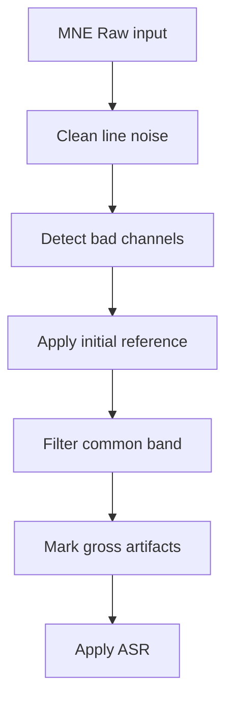
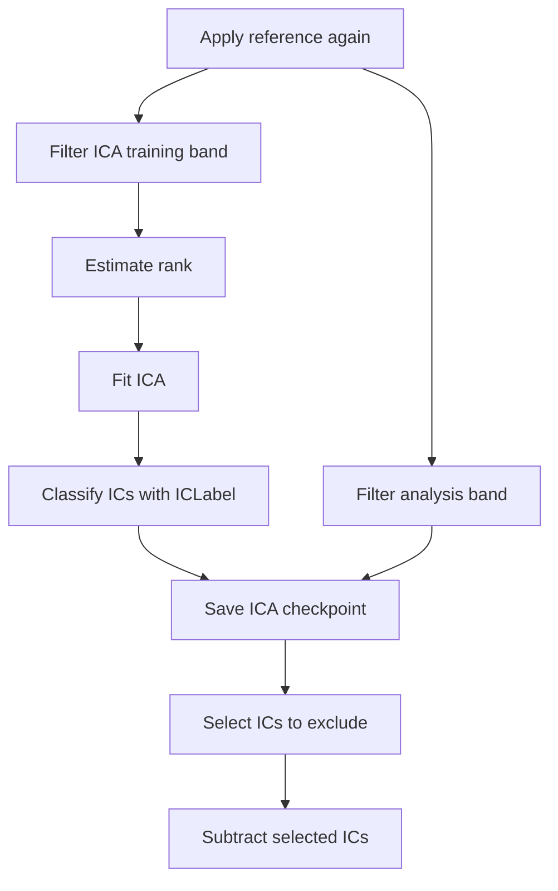
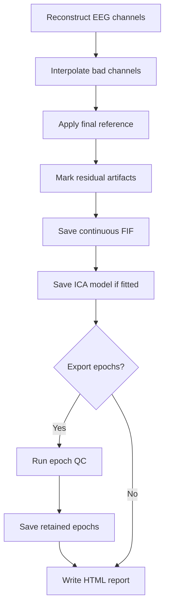

# eegproc

[中文](README.zh-CN.md) · [GitHub](https://github.com/LeiGuo0812/eegproc)

eegproc preprocesses resting-state and task EEG through MNE. It accepts continuous Raw data and combines line-noise removal, bad-channel detection, ASR, ICLabel-assisted ICA, and continuous or event-level quality control. Results include MNE FIF data and a self-contained HTML report with editable ICA selections.

Configure the workflow directly in Python, or use JSON and the command line. Every ICA run keeps a checkpoint for revising component exclusions without repeating the decomposition.

## Installation

Use **Python 3.12** and an activated virtual environment:

```bash
python -m pip install "eegproc @ git+https://github.com/LeiGuo0812/eegproc.git"
```

From a downloaded or cloned repository, run `python -m pip install -r requirements.txt` in its root directory. `requirements-all.txt` adds all optional runtime backends. See [installation](docs/en/installation.md) for Windows, Linux, macOS and dependency options.

## Quick start

```python
import mne
from eegproc import run

raw = mne.io.read_raw_fif("prepared/sub01_raw.fif", preload=False)
result = run(
    raw, save_path="outputs/sub01_rest", subject="sub01",
    purpose="rest", task_name="eyes_closed",
)
clean_raw = result.raw
print(result.status, result.outputs["quality_report"])
```

Prepare EEG/EOG/ECG in volts, electrode coordinates in metres, and correct channel types, montage and event timing. Device conversion is handled separately by `eegproc.preparation.prepare_data`. The input Raw is not modified; original BAD annotations and auxiliary samples are retained.

For a task recording with stimulus annotations `"1"` and `"2"`:

```python
task_raw = mne.io.read_raw_fif("prepared/sub01_task_raw.fif", preload=False)
events, _ = mne.events_from_annotations(task_raw, event_id={"1": 1, "2": 2})
erp = run(
    task_raw, "outputs/sub01_oddball", "sub01",
    purpose="erp", task_name="oddball",
    events=events, event_id={"standard": 1, "target": 2},
    epoch_tmin=-0.2, epoch_tmax=1.0,
)
```

`purpose` selects analysis defaults; `task_name` labels the recording. Supplying events requests event epochs. Inspect the HTML report and condition retention before accepting the data for analysis. Use a fresh output directory for each run.

| Standard default | Rest | ERP |
|---|---|---|
| Analysis band | 0.5–80 Hz | 0.1–30 Hz |
| ICA training band | 1–100 Hz | 1–100 Hz |
| ASR | Enabled; cutoff 20 | Enabled; cutoff 20 |
| ICA / automatic selection | Picard / ICLabel thresholds | Picard / ICLabel thresholds |
| Epoch export | When requested | When requested |
| Report waveform window | 4 s | 4 s |

All presets, including `eeglab`, request **1–100 Hz for ICA training**. Analysis bands remain separately configurable. The effective training band is limited by the input's existing filters and sampling frequency; any adjustment is recorded in the report.

## Epoch later and defer reports

Use `epoch()` for an already preprocessed Raw. It performs only epoch construction and QC; it does not repeat filtering, ASR or ICA and does not require the original recording.

```python
from eegproc import run, epoch, render_report

prep = run(task_raw, "outputs/sub01_prep", "sub01", purpose="erp",
           task_name="oddball", report=False)
seg = epoch(
    prep.raw, "outputs/sub01_epochs", "sub01",
    events=events, event_id={"standard": 1, "target": 2},
    tmin=-0.2, tmax=1.0, baseline=(-0.2, 0.0), report=False,
)
render_report(seg, "outputs/sub01_epochs/sub01_report.html")
epochs = seg.epochs
```

`run()`, `epoch()` and `resume()` default to `report=True`, with rendering isolated in a fresh subprocess. With `report=False`, no figures or HTML are produced; one `*_report_data.npz` stores bounded diagnostic material for later rendering. The eegproc collector does not import Agg or font rendering; upstream MNE operations may still import Matplotlib. No full original Raw is copied. `render_report()` accepts a result, an existing HTML, or a report-data package and uses the same isolated renderer. Report status is `completed`, `partial`, `failed` or `deferred`, separate from processing status. Incomplete rendering retains compact material and an error log for recovery.

`epoch()` reads BAD origins and global bad-channel information from the cleaned Raw/FIF. Input, manual and unknown BAD remain exclusions; event-window QC reevaluates only marked automatic residuals. It automatically looks for the previous HTML or report-data package; use `source_report="path/to/report.html"` to select one explicitly. Missing or unreadable reports produce a warning and an independent epoch report. Source HTML is kept by default. See [standalone epoching and reports](docs/en/usage.md#standalone-epoching).

The corresponding commands are `eegproc-epoch` and `eegproc-report`. Run [epoch_and_report.py](examples/epoch_and_report.py) for a complete generated-data example.

## Batch and parallel processing

Use the [CSV batch example](examples/batch_process.py) to run each recording in a fresh process. The parent records ordinary errors, unexpected process exits and timeouts while other recordings continue. Reports are rendered in separate subprocesses after completed EEG results have been saved.

```bash
python examples/batch_process.py manifest.csv --output outputs/cohort --workers 2
# Continue the same batch after an interruption or report failure:
python examples/batch_process.py manifest.csv --output outputs/cohort --workers 2 --resume
```

The manifest and directory layout are described in [Complete usage](docs/en/usage.md#executable-examples). Keep the manifest rows unchanged when resuming. Completed recordings are skipped; deferred, partial or failed reports are retried from saved report data, without repeating preprocessing. Failed or incomplete scientific processing needs a new output directory after the cause is resolved. The example does not automatically retry scientific computation.

`--workers` defaults to 1 and controls concurrent recordings; every worker uses `n_threads=1` and sets numerical thread variables before importing EEG libraries. `--timeout` defaults to 86400 seconds per recording; a timed-out worker and its report child processes are terminated together. Start with one or two workers and measure peak memory before increasing concurrency. Inspect both processing and report status in `batch_summary.json`. Ctrl+C stops active worker trees, cancels queued rows and saves the recovery summary. A small `batch_result.json` per recording supports recovery; failed attempts retain logs and report material. Completed reports remove their batch-generated package and worker log.

## Workflow and outputs

### 1. Signal preparation



### 2. ICA decomposition



### 3. Reconstruction and outputs



ICA and interpolation steps follow the selected settings. The [detailed workflow](docs/en/workflow.md) includes optional paths, ECG support and manual ICA continuation.

Output from the quick-start example above:

```text
outputs/sub01_rest/
├── sub01_cont_raw.fif          Cleaned continuous data
├── sub01-ica.fif               ICA model and final exclusions
├── sub01_report.html           Figures, QC, settings and provenance
└── sub01_ica_review/
    ├── pre_ica_raw.fif         Data before component subtraction
    ├── decomposition-ica.fif   Frozen ICA decomposition
    └── checkpoint.json        Continuation state
```

Requested epochs add `sub01_clean-epo.fif` when trials remain. Report figures and tables are embedded in the HTML. With `report=False`, `sub01_report_data.npz` replaces the immediate HTML. Standalone `epoch()` writes only retained epoch FIF and an HTML or report-data package. Continuous BAD annotations mark problematic intervals without deleting samples.

To review before subtraction, set `ica_mode="review"`. To revise an automatic result, open its report and change **Exclude** on an IC tile or its detail view. Download the selection and call `resume()` with the checkpoint. A new complete list can restore previously removed components; filtering, ASR and ICA fitting are reused. Keep the original prepared input and all checkpoint files. See [ICA review and continuation](docs/en/usage.md#ica-review-and-continuation).

## Documentation

| Topic | English | 中文 |
|---|---|---|
| Installation and dependencies | [Installation](docs/en/installation.md) | [安装教程](docs/zh-CN/installation.md) |
| Processing stages and file delivery | [Workflow diagrams](docs/en/workflow.md) | [处理流程图](docs/zh-CN/workflow.md) |
| Preparation, rest, ERP, batch, ICA review and CLI | [Complete usage](docs/en/usage.md) | [完整使用示例](docs/zh-CN/usage.md) |
| Parameters, defaults and dependencies | [Parameters](docs/en/parameters.md) | [参数说明](docs/zh-CN/parameters.md) |
| Report, BAD labels and acceptance decisions | [Interpreting results](docs/en/results.md) | [结果解读](docs/zh-CN/results.md) |
| PSD, ERP, time-frequency, connectivity and statistics | [Further analysis](docs/en/analysis.md) | [后续分析建议](docs/zh-CN/analysis.md) |

Run the [synthetic example](examples/synthetic_demo.py) from a repository checkout to explore rest, ERP and ICA continuation:

```bash
python examples/synthetic_demo.py --output outputs/demo
```

More [executable examples](examples) cover real-data preparation, batch processing and downstream analysis.

Licensed under [BSD 3-Clause](LICENSE); see [third-party notices](docs/THIRD_PARTY_NOTICES.md) for included components.
