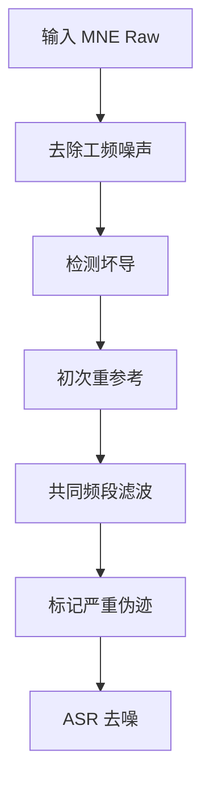
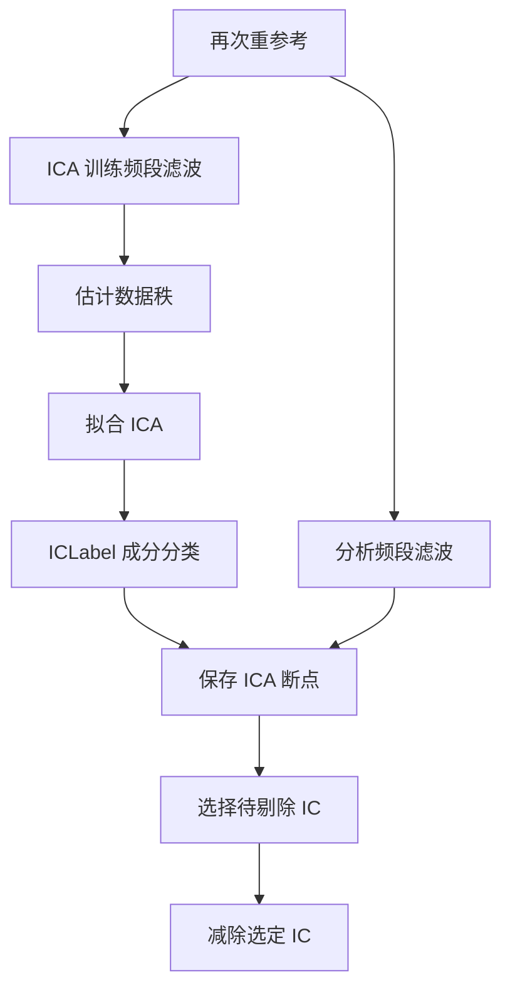
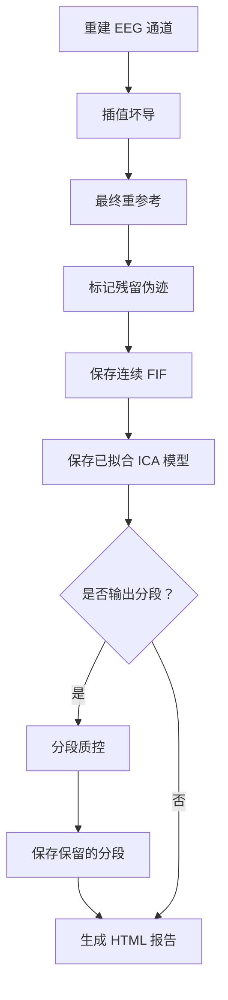

# eegproc

[English](README.md) · [GitHub](https://github.com/LeiGuo0812/eegproc)

eegproc 是基于 MNE 的静息态与任务脑电预处理软件包。输入连续 Raw 数据，完成工频去除、坏导检测、ASR、ICLabel 辅助 ICA，以及连续信号或事件窗质控；输出 MNE FIF 数据和单文件 HTML 报告，支持在报告中调整 ICA 成分选择。

优先通过 Python 代码配置，也支持 JSON 和命令行。每次 ICA 运行保留断点，方便修改剔除列表，无需重新分解。

## 安装

推荐使用 **Python 3.12**，创建并启用虚拟环境后执行：

```bash
python -m pip install "eegproc @ git+https://github.com/LeiGuo0812/eegproc.git"
```

也可下载或克隆仓库，在根目录执行 `python -m pip install -r requirements.txt`。`requirements-all.txt` 包含全部可选运行后端。Windows、Linux、macOS 环境配置及依赖选择见[安装教程](docs/zh-CN/installation.md)。

## 快速开始

```python
import mne
from eegproc import run

raw = mne.io.read_raw_fif("prepared/sub01_raw.fif", preload=False)
result = run(
    raw, save_path="outputs/sub01_rest", subject="sub01",
    purpose="rest", task_name="eyes_closed",
)
clean_raw = result.raw
print(result.status, result.outputs["quality_report"])
```

输入前确认 EEG/EOG/ECG 单位为 V，电极坐标单位为 m，并正确设置通道类型、montage 和事件时间。设备文件由 `eegproc.preparation.prepare_data` 单独准备。流程不修改输入 Raw，保留原始 BAD 注释和辅助通道样本。

如果任务记录的刺激注释为 `"1"` 和 `"2"`：

```python
task_raw = mne.io.read_raw_fif("prepared/sub01_task_raw.fif", preload=False)
events, _ = mne.events_from_annotations(task_raw, event_id={"1": 1, "2": 2})
erp = run(
    task_raw, "outputs/sub01_oddball", "sub01",
    purpose="erp", task_name="oddball",
    events=events, event_id={"standard": 1, "target": 2},
    epoch_tmin=-0.2, epoch_tmax=1.0,
)
```

`purpose` 选择分析默认参数，`task_name` 记录具体任务名称。传入事件会请求事件分段。处理完成后查看 HTML 报告及各条件保留情况，再决定是否进入分析。每次运行使用新的输出目录。

| 标准默认参数 | 静息态 | ERP |
|---|---|---|
| 分析频段 | 0.5–80 Hz | 0.1–30 Hz |
| ICA 训练频段 | 1–100 Hz | 1–100 Hz |
| ASR | 开启；cutoff=20 | 开启；cutoff=20 |
| ICA / 自动选择 | Picard / ICLabel 阈值 | Picard / ICLabel 阈值 |
| 分段导出 | 按需请求 | 按需请求 |
| 报告波形时间窗 | 4 秒 | 4 秒 |

## 后续独立分段与延迟报告

已完成连续预处理的 Raw 可直接调用 `epoch()`。它只执行分段和质控，不重复滤波、ASR 或 ICA，也不依赖预处理前的原始记录。

```python
from eegproc import run, epoch, render_report

prep = run(task_raw, "outputs/sub01_prep", "sub01", purpose="erp",
           task_name="oddball", report=False)
seg = epoch(
    prep.raw, "outputs/sub01_epochs", "sub01",
    events=events, event_id={"standard": 1, "target": 2},
    tmin=-0.2, tmax=1.0, baseline=(-0.2, 0.0), report=False,
)
render_report(seg, "outputs/sub01_epochs/sub01_report.html")
epochs = seg.epochs
```

`run()`、`epoch()`、`resume()` 均默认 `report=True`，报告交给全新子进程绘制。`report=False` 时不绘图、不写 HTML，只保存一个 `*_report_data.npz`，供后续生成报告。eegproc 的数值采集模块不主动导入 Agg 或字体渲染组件；MNE 自身的操作仍可能导入 Matplotlib。不复制整份原始 Raw。`render_report()` 可接收结果对象、已有 HTML 或报告数据包，并使用相同的隔离渲染方式。报告状态区分 `completed`、`partial`、`failed` 和 `deferred`，与处理状态分开；报告不完整时保留有限素材和错误日志供恢复。

`epoch()` 从清理后 Raw/FIF 读取 BAD 来源和全局坏导信息。原有、人工及未知来源 BAD 继续参与拒绝；事件窗质控只重新检查明确标记的自动残留。程序自动查找此前的 HTML 或报告包，也可通过 `source_report="path/to/report.html"` 手动指定。报告缺失或无法读取时提醒，并生成独立分段报告。默认保留原 HTML，详见[独立分段与报告](docs/zh-CN/usage.md#独立分段)。

命令行入口为 `eegproc-epoch` 和 `eegproc-report`。[epoch_and_report.py](examples/epoch_and_report.py) 提供完整的生成数据示例。

## 批量与并行处理

[CSV 批处理示例](examples/batch_process.py) 为每份记录启动全新进程。父进程记录普通异常、进程意外退出和超时，其余记录继续处理。报告在 EEG 结果保存完成后，通过独立子进程生成。

```bash
python examples/batch_process.py manifest.csv --output outputs/cohort --workers 2
# 中断或报告失败后，继续同一批次：
python examples/batch_process.py manifest.csv --output outputs/cohort --workers 2 --resume
```

清单与目录格式见[完整使用教程](docs/zh-CN/usage.md#可执行示例)。恢复时保持清单各行不变。已完成的记录跳过；延迟、缺图或失败的报告仅从保存素材重试，不重复预处理。科学处理失败或输出不完整时，解决原因后使用新输出目录重新处理，示例不会自动重跑科学计算。

`--workers` 默认为 1，控制同时处理的记录数；每个 worker 使用 `n_threads=1`，并在导入 EEG 库前设置数值线程环境。`--timeout` 默认每份记录 86400 秒，超时会一并终止该 worker 及其报告子进程。建议从一至两个 worker 开始，测量内存峰值后再增加。请同时检查 `batch_summary.json` 中的处理状态与报告状态。Ctrl+C 会终止活动 worker 树、取消排队记录，并保存恢复摘要；每份记录的简短 `batch_result.json` 用于恢复。失败尝试保留日志和报告素材，完整报告生成后删除批处理自建的素材包和 worker 日志。

## 流程与输出

### 1. 信号准备



### 2. ICA 分解



### 3. 重建与输出



ICA 和插值步骤按所选参数执行。[详细流程图](docs/zh-CN/workflow.md)列出可选分支、ECG 辅助及 ICA 人工复核续处理。

上方快速开始示例的输出：

```text
outputs/sub01_rest/
├── sub01_cont_raw.fif          清理后的连续数据
├── sub01-ica.fif               ICA 模型及最终排除列表
├── sub01_report.html           图表、质控、参数和来源记录
└── sub01_ica_review/
    ├── pre_ica_raw.fif         减除成分前的数据
    ├── decomposition-ica.fif   冻结 ICA 分解
    └── checkpoint.json        续处理状态
```

请求分段且有保留试次时，另输出 `sub01_clean-epo.fif`。报告图片和表格直接嵌入 HTML。`report=False` 时以 `sub01_report_data.npz` 替代即时 HTML；独立 `epoch()` 只写保留的分段 FIF 和 HTML 或报告包。连续 BAD 注释标记问题区间，不删除采样点。

若希望先复核再减除，设置 `ica_mode="review"`。若要修改已完成的自动结果，在报告的 IC 卡片或详情中调整 **Exclude**，下载选择文件，再用断点调用 `resume()`。新的完整列表可恢复先前删除的成分，复用原滤波、ASR 和 ICA 分解。请保留准备后的原始输入和全部断点文件，具体操作见[使用示例](docs/zh-CN/usage.md)。

## 文档导航

| 内容 | 中文 | English |
|---|---|---|
| 安装与依赖 | [安装教程](docs/zh-CN/installation.md) | [Installation](docs/en/installation.md) |
| 处理阶段与文件交付 | [处理流程图](docs/zh-CN/workflow.md) | [Workflow diagrams](docs/en/workflow.md) |
| 数据准备、静息态、ERP、批处理、ICA 复核和命令行 | [完整使用示例](docs/zh-CN/usage.md) | [Complete usage](docs/en/usage.md) |
| 参数、默认值与依赖关系 | [参数说明](docs/zh-CN/parameters.md) | [Parameters](docs/en/parameters.md) |
| 报告、BAD 注释和人工判定 | [结果解读](docs/zh-CN/results.md) | [Interpreting results](docs/en/results.md) |
| 功率谱、ERP、时频、连接与统计 | [后续分析建议](docs/zh-CN/analysis.md) | [Further analysis](docs/en/analysis.md) |

在仓库目录运行[模拟示例](examples/synthetic_demo.py)，体验静息态、ERP 和 ICA 续处理：

```bash
python examples/synthetic_demo.py --output outputs/demo
```

更多[可运行示例](examples)覆盖真实数据准备、批处理和后续分析。

采用 [BSD 3-Clause 许可证](LICENSE)；所含组件的许可见[第三方说明](docs/THIRD_PARTY_NOTICES.md)。
