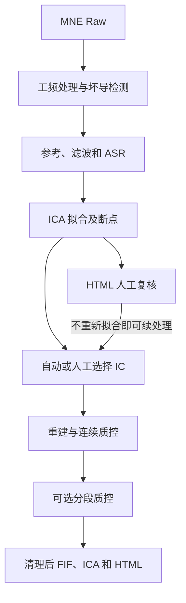

# eegproc

[English](README.md) · [GitHub](https://github.com/LeiGuo0812/eegproc)

eegproc 是基于 MNE 的静息态与任务脑电预处理软件包。输入连续 Raw 数据，完成工频去除、坏导检测、ASR、ICLabel 辅助 ICA，以及连续信号或事件窗质控；输出 MNE FIF 数据和单文件 HTML 报告，支持在报告中调整 ICA 成分选择。

优先通过 Python 代码配置，也支持 JSON 和命令行。每次 ICA 运行保留断点，方便修改剔除列表，无需重新分解。

## 安装

推荐使用 **Python 3.12**，创建并启用虚拟环境后执行：

```bash
python -m pip install "eegproc @ git+https://github.com/LeiGuo0812/eegproc.git"
```

也可下载或克隆仓库，在根目录执行 `python -m pip install -r requirements.txt`。`requirements-all.txt` 包含全部可选运行后端。Windows、Linux、macOS 环境配置及依赖选择见[安装教程](docs/zh-CN/installation.md)。

## 快速开始

```python
import mne
from eegproc import run

raw = mne.io.read_raw_fif("prepared/sub01_raw.fif", preload=False)
result = run(
    raw, save_path="outputs/sub01_rest", subject="sub01",
    purpose="rest", task_name="eyes_closed",
)
clean_raw = result.raw
print(result.status, result.outputs["quality_report"])
```

输入前确认 EEG/EOG/ECG 单位为 V，电极坐标单位为 m，并正确设置通道类型、montage 和事件时间。设备文件由 `eegproc.preparation.prepare_data` 单独准备。流程不修改输入 Raw，保留原始 BAD 注释和辅助通道样本。

如果任务记录的刺激注释为 `"1"` 和 `"2"`：

```python
task_raw = mne.io.read_raw_fif("prepared/sub01_task_raw.fif", preload=False)
events, _ = mne.events_from_annotations(task_raw, event_id={"1": 1, "2": 2})
erp = run(
    task_raw, "outputs/sub01_oddball", "sub01",
    purpose="erp", task_name="oddball",
    events=events, event_id={"standard": 1, "target": 2},
    epoch_tmin=-0.2, epoch_tmax=1.0,
)
```

`purpose` 选择分析默认参数，`task_name` 记录具体任务名称。传入事件会请求事件分段。处理完成后查看 HTML 报告及各条件保留情况，再决定是否进入分析。每次运行使用新的输出目录。

| 标准默认参数 | 静息态 | ERP |
|---|---|---|
| 分析频段 | 0.5–80 Hz | 0.1–30 Hz |
| ICA 训练频段 | 1–100 Hz | 1–100 Hz |
| ASR | 开启；cutoff=20 | 开启；cutoff=20 |
| ICA / 自动选择 | Picard / ICLabel 阈值 | Picard / ICLabel 阈值 |
| 分段导出 | 按需请求 | 按需请求 |
| 报告波形时间窗 | 4 秒 | 4 秒 |

## 并行处理

支持使用独立进程同时处理多份记录。`max_workers` 决定同时处理的记录数；`n_threads` 限制单份记录中受支持的数值库线程池，不会自动启动批处理任务。仓库中的 CSV 批处理示例仍按顺序运行。

将以下代码单独保存为 `parallel_preprocess.py`，在终端执行 `python parallel_preprocess.py`：

```python
import os

# 在导入 NumPy、MNE 或 PyTorch 前设置。
for name in ("OMP_NUM_THREADS", "OPENBLAS_NUM_THREADS", "MKL_NUM_THREADS"):
    os.environ[name] = "1"

from concurrent.futures import ProcessPoolExecutor
from multiprocessing import get_context
from pathlib import Path


def process_one(job):
    recording_id, input_fif = job
    import mne
    from eegproc import run

    with mne.io.read_raw_fif(input_fif, preload=False, verbose=False) as raw:
        result = run(
            raw, Path("outputs_parallel") / recording_id, recording_id,
            purpose="rest", task_name="eyes_closed", n_threads=1,
        )
        return (recording_id, result.status, result.report.get("report_status"),
                result.outputs["quality_report"])


if __name__ == "__main__":
    jobs = [
        ("sub01_rest", "prepared/sub01_raw.fif"),
        ("sub02_rest", "prepared/sub02_raw.fif"),
    ]
    with ProcessPoolExecutor(max_workers=2, mp_context=get_context("spawn")) as pool:
        for recording_id, status, report_status, html in pool.map(process_one, jobs):
            print(f"{recording_id}: {status}; report={report_status}; {html}")
```

worker 函数应定义在模块顶层，并保留 `__main__` 保护；请作为 `.py` 脚本运行，不直接放入 Notebook 单元格（参见 [Python 进程池要求](https://docs.python.org/3/library/concurrent.futures.html#concurrent.futures.ProcessPoolExecutor)）。各 `recording_id` 必须唯一，每份记录都要使用独立的**新输出目录**；同一受试者的不同任务或 session 也需区分。向子进程传文件路径，只返回简短状态和报告路径，避免跨进程传递 Raw 或 PipelineResult 大对象。

建议先用两个进程、每次 `n_threads=1`，再根据内存增加进程数；每个进程仍会加载完整记录及处理缓冲。环境变量用于减少嵌套数值线程；`n_threads` 不保证整个进程严格只有指定数量的线程。绘图和日志具有进程级状态，因此并发调用流程时使用独立进程。用于 ERP 时，在 worker 中设置 `purpose="erp"`、相应 `task_name`，并按前面的任务示例传入该记录的事件。

## 流程与输出



上方快速开始示例的输出：

```text
outputs/sub01_rest/
├── sub01_cont_raw.fif          清理后的连续数据
├── sub01-ica.fif               ICA 模型及最终排除列表
├── sub01_report.html           图表、质控、参数和来源记录
└── sub01_ica_review/
    ├── pre_ica_raw.fif         减除成分前的数据
    ├── decomposition-ica.fif   冻结 ICA 分解
    └── checkpoint.json        续处理状态
```

请求分段且有保留试次时，另输出 `sub01_clean-epo.fif`。报告图片和表格直接嵌入 HTML。连续 BAD 注释标记问题区间，不删除采样点。

若希望先复核再减除，设置 `ica_mode="review"`。若要修改已完成的自动结果，在报告的 IC 卡片或详情中调整 **Exclude**，下载选择文件，再用断点调用 `resume()`。新的完整列表可恢复先前删除的成分，复用原滤波、ASR 和 ICA 分解。请保留准备后的原始输入和全部断点文件，具体操作见[使用示例](docs/zh-CN/usage.md)。

## 文档导航

| 内容 | 中文 | English |
|---|---|---|
| 安装与依赖 | [安装教程](docs/zh-CN/installation.md) | [Installation](docs/en/installation.md) |
| 处理阶段与文件交付 | [处理流程图](docs/zh-CN/workflow.md) | [Workflow diagrams](docs/en/workflow.md) |
| 数据准备、静息态、ERP、批处理、ICA 复核和命令行 | [完整使用示例](docs/zh-CN/usage.md) | [Complete usage](docs/en/usage.md) |
| 参数、默认值与依赖关系 | [参数说明](docs/zh-CN/parameters.md) | [Parameters](docs/en/parameters.md) |
| 报告、BAD 注释和人工判定 | [结果解读](docs/zh-CN/results.md) | [Interpreting results](docs/en/results.md) |
| 功率谱、ERP、时频、连接与统计 | [后续分析建议](docs/zh-CN/analysis.md) | [Further analysis](docs/en/analysis.md) |

在仓库目录运行[模拟示例](examples/synthetic_demo.py)，体验静息态、ERP 和 ICA 续处理：

```bash
python examples/synthetic_demo.py --output outputs/demo
```

更多[可运行示例](examples)覆盖真实数据准备、批处理和后续分析。

采用 [BSD 3-Clause 许可证](LICENSE)；所含组件的许可见[第三方说明](docs/THIRD_PARTY_NOTICES.md)。
