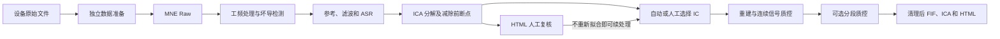

# eegproc

[English](README.md) · **0.4.0a1** · [GitHub](https://github.com/LeiGuo0812/eegproc)

基于 MNE Raw 的脑电预处理流程，提供独立 ASR、ICLabel 辅助 ICA、可重新选择的 IC 剔除、事件窗质控，以及单文件 HTML 报告。优先通过 Python 代码传参，也支持 JSON 配置和命令行。

## 安装

完整功能推荐使用 **Python 3.12**。创建并启用虚拟环境后，可直接从 GitHub 安装：

```bash
python -m pip install "eegproc @ git+https://github.com/LeiGuo0812/eegproc.git"
```

也可以下载或克隆仓库，进入包含 `pyproject.toml` 的根目录：

```bash
python -m pip install -r requirements.txt
# 包含所有可选运行后端：
python -m pip install -r requirements-all.txt
```

安装包名称与导入名称均为 `eegproc`，不依赖 MATLAB。这些命令从 GitHub 或源码安装，不要求软件已发布到 PyPI。Windows、Linux、macOS 环境配置、可选依赖和版本固定方法见[安装教程](docs/zh-CN/installation.md)。

## 第一次运行

```python
import mne
from eegproc import run

raw = mne.io.read_raw_fif("prepared/sub01_raw.fif", preload=False)
result = run(
    raw,
    save_path="outputs/sub01_rest",
    subject="sub01",
    purpose="rest",
    task_name="eyes_closed",
)
print(result.status)
print(result.outputs["quality_report"])
clean_raw = result.raw
```

输入前应确认物理单位、通道类型、电极坐标和事件时间正确。`purpose` 决定静息态或 ERP 默认参数；`task_name` 仅记录具体任务名称。输入中的人工 BAD 标记和辅助通道会被保留。处理完成后，先查看报告，再决定是否进入统计分析。

| 默认项目 | 静息态 | ERP |
|---|---|---|
| 分析频段 | 0.5–80 Hz | 0.1–30 Hz |
| ICA 训练频段 | 1–100 Hz | 1–100 Hz |
| ASR | 开启；cutoff=20 | 开启；cutoff=20 |
| ICA | Picard；ICLabel 阈值法 | Picard；ICLabel 阈值法 |
| 分段导出 | 明确请求后进行 | 明确请求后进行 |
| 报告波形时间窗 | 4 秒 | 4 秒 |

`preset="eeglab"` 在同一流程内切换参数，用纯 Python 近似对齐原 EEGLAB 脚本，不代表 MATLAB 数值完全复现。全部参数见[参数说明](docs/zh-CN/parameters.md)。

## 流程与输出



```text
outputs/sub01_rest/
├── sub01_cont_raw.fif
├── sub01-ica.fif
├── sub01_report.html
└── sub01_ica_review/
    ├── pre_ica_raw.fif
    ├── decomposition-ica.fif
    └── checkpoint.json
```

请求分段且至少保留一个试次时，另输出 `sub01_clean-epo.fif`。图片与表格均嵌入 HTML。每次 ICA 运行保留减除前断点；修改 IC 列表后可恢复原先删除的成分，无需重做滤波、ASR 或 ICA 拟合。操作见[完整使用示例](docs/zh-CN/usage.md)。

## 文档导航

| 内容 | 中文 | English |
|---|---|---|
| 安装、依赖和安装验证 | [安装教程](docs/zh-CN/installation.md) | [Installation](docs/en/installation.md) |
| 数据准备、静息态、ERP、批处理、ICA 复核、命令行 | [完整使用示例](docs/zh-CN/usage.md) | [Complete usage](docs/en/usage.md) |
| 所有参数、默认值和依赖关系 | [参数说明](docs/zh-CN/parameters.md) | [Parameters](docs/en/parameters.md) |
| 报告、产出文件、BAD 标记和人工判定 | [结果解读](docs/zh-CN/results.md) | [Interpreting results](docs/en/results.md) |
| 功率谱、ERP、时频、连接和统计 | [后续分析建议](docs/zh-CN/analysis.md) | [Further analysis](docs/en/analysis.md) |

[可运行示例](examples) · [架构说明](docs/ARCHITECTURE.md) · [发布检查](docs/RELEASE_AUDIT.md) · [第三方说明](docs/THIRD_PARTY_NOTICES.md)

不下载数据集即可运行完整模拟示例：

```bash
python examples/synthetic_demo.py --output outputs/demo
```

示例包含静息态、ERP、ICA 复核、续处理和报告重建。[结果解读](docs/zh-CN/results.md)提供实际生成图及说明。这些图用于展示软件用法，不代表不同算法去噪精度的比较。

当前为科研用途 alpha 版本，采用 [BSD 3-Clause 许可证](LICENSE)，另保留[第三方条款](docs/THIRD_PARTY_NOTICES.md)。实际验证记录见发布检查。请保留实际参数、软件版本、准备后的输入文件和 ICA 断点。
