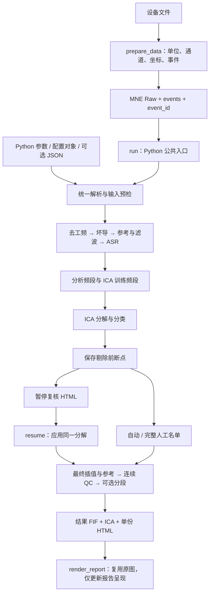

# EEG preprocessing：架构与接口

版本 **0.3.1** · 更新日期 **2026-10-22**。统一接收 MNE Raw，以 Python 参数为主要入口；配置文件和命令行是补充接口。本次调整工程结构、参数解析、内存生命周期及文件交付，处理算法、阶段顺序和预设默认参数保持不变。

[调用示例](../examples/code_first.py) · [完整参数清单](PARAMETERS.html) · 回归与内存验证 (local research record; excluded from this source snapshot) · [项目说明](../README.md)

## 数据流与职责



处理核心不负责猜测原始设备单位或任务意义。`task_name` 是记录名称，`purpose` 决定分析默认值。报告生成不参与清理决策；人工勾选只生成下一次 ICA 应用的名单。

| 层级 | 主要模块 | 边界 |
|---|---|---|
| 数据准备 | `preparation.py`、`io/` | 返回 Raw、事件、校准信息；不滤波、不去伪迹 |
| 公共接口 | `api.py`、`__init__.py` | `run`、`resume`、`render_report` 和明确的结果对象 |
| 配置与命令行 | `settings.py`、`configuration.py`、`parameter_resolution.py`、`runtime_parameters.py`、`cli.py` | 统一解析、依赖与输入约束、调整审计；CLI 调用公共 API |
| 执行调度 | `engine.py`、`stages.py`、`delivery.py` | 阶段顺序、状态、后处理和交付 |
| 信号算法 | `backends.py`、`signal_ops.py`、`ica.py`、`mne_asr/` | 滤波、坏导、ASR、ICA 及成分应用 |
| 分段 | `epochs.py`、`epoch_export.py` | 事件窗质控、严格分段及显式启用的局部修复 |
| 断点与兼容 | `review.py`、`checkpoint_input.py`、`compatibility.py` | 校验输入、冻结分解、计算兼容契约 |
| 文件交付 | `storage.py` | 路径冲突预检、暂存校验、提交和分片清单 |
| 报告 | `quality_report.py`、`quality_figures.py`、`report_layout.py`、`reporting.py` | 单份英文 HTML、复核交互、独立报告重建 |
| 溯源 | `report_provenance.py`、`line_diagnostics.py` | 处理记录、元数据核验、阶段工频诊断 |

## 项目目录

```text
project/
├── pyproject.toml                 可安装包、依赖与命令行入口
├── README.md
├── eegproc/                  唯一生产实现，不依赖工作目录
│   ├── __init__.py / api.py        公共 Python 接口
│   ├── settings.py / configuration.py
│   ├── parameter_resolution.py / runtime_parameters.py
│   ├── engine.py / stages.py / delivery.py
│   ├── backends.py / signal_ops.py / ica.py
│   ├── epochs.py / epoch_export.py
│   ├── review.py / checkpoint_input.py / compatibility.py
│   ├── storage.py
│   ├── preparation.py / cli.py
│   ├── quality_report.py / quality_figures.py
│   ├── report_layout.py / reporting.py / report_provenance.py
│   ├── line_diagnostics.py / raw_helpers.py / _utils.py
│   ├── pipeline.py                旧导入方式的兼容接口
│   ├── io/                        Neuracle 读取及 MNE 转换
│   ├── mne_asr/                   独立 ASR；附原始来源与许可证
│   ├── resources/                 随包安装的坐标资源
│   └── RELEASE_STATUS.md          发布与许可证状态
├── examples/code_first.py         Python 代码调用示例
├── configs/                       可选简短配置文件
├── tests/                         配置、数值、元数据、续处理和 I/O 回归
│   └── fixtures/                  历史固定数值样本
├── scripts/                       集成验证和性能测量入口
├── docs/                          架构、验证与历史科学比较
├── results/                       结果与比较，不参与生产运行
├── licenses/                      第三方许可证
├── preprocess.py / prepare_data.py 兼容命令行入口
├── erp_outputs.py / mne_bridge.py / neuracle_io.py / mne_asr/
│                                  旧导入路径的薄转发接口
├── python/common/                 旧目录兼容转发，无独立算法分支
├── project_layout.py              旧项目脚本路径兼容
└── requirements*.txt              已记录环境依赖
```

`build/`、`*.egg-info/`、缓存和临时验证工作区是构建/验证产物，不属于算法结构。旧转发接口指向包内实现；生产包不再通过 `sys.path` 注入寻找公共代码。安装名是 `eegproc`，导入名是 `eegproc`。

## 代码传参

```python
from eegproc import PipelineConfig, resolve_config, run

# 直接传入每个科学参数。
rest = run(raw, "outputs/rest", "sub01", purpose="rest", task_name="eyes_closed")

# 复用不可变配置；构造器和解析器含义一致。
cfg = PipelineConfig(purpose="erp", task_name="oddball", epoch_mode="events")
erp = run(raw, "outputs/erp", "sub01", config=cfg,
          events=events, event_id={"standard": 1, "target": 2})

# 字典使用相同字段。
cfg = resolve_config({"purpose": "erp", "task_name": "oddball"})

# 文件仅在明确提供时读取；本次代码覆盖优先。
configured = run(raw, "outputs/configured", "sub01",
                 config_file="configs/rest.json", task_name="eyes_open")
```

优先级为：**预设默认值 → 可选文件 → 配置对象/字典 → 本次关键字参数**。配置对象包含当时解析出的全部字段值；需要另一套用途默认值时构造新对象。`dataclasses.replace` 保留未指定字段，但字段之间的依赖仍由解析器处理；实际输入相关的调整以运行报告为准。

`None`、`False`、空列表与“未提供”不同。统一解析器检查参数类型、有限值、范围和相互依赖；无效科学值采用相应回退，未知键忽略，不适用的依赖设置自动调整。构造时的调整记录在 `config.adjustments`，完整运行期参数调整记录在报告中，并在 HTML Summary 显示请求值、生效值及原因。已满足依赖、输入和后端约束的请求沿用原值，预设声明的默认值不变。采样率、坐标等依赖 Raw 的条件在输入预检处理。`asr_options` 会复制并冻结，外部修改原字典不会改变正在运行的配置。完整规则见[参数清单](PARAMETERS.html)。

自动回退只处理已定义的配置问题、输入约束和可选分段请求。真实数据读取、采集元数据、路径冲突、必需环境依赖或数值计算错误仍明确报告为错误或运行失败，显式 QC 停止策略继续生效。

`purpose="erp"` 不隐式导出 epochs；使用 `epoch_mode="events"` 或提供显式事件。事件样本为含 `first_samp` 的绝对 MNE 样本号。旧 `EpochConfig` 仍可完整覆盖分段阶段，额外修复参数不丢失；该覆盖不改变连续质控阈值，报告记录实际生效分段配置。

## 保留的默认值

| 参数 | standard + rest | standard + erp |
|---|---|---|
| 分析频段 | 0.5–80 Hz | 0.1–30 Hz |
| ICA 训练频段 | 1–100 Hz | 1–100 Hz |
| ASR cutoff | 20 | 20 |
| ICA / 剔除规则 | Picard / threshold | Picard / threshold |
| 分段 | 默认不导出 | 默认不导出 |
| 报告波形窗 | 4 秒 | 4 秒 |

`eeglab` 仍为同一流程中的参数预设：分析与训练频段均 0.5–100 Hz，EEGLAB FIR、EEGPrep 坏导、Infomax、协方差秩和 `class_max`。四种用途/预设的完整默认字典均以冻结旧版本进行核对。没有引入 MATLAB 调用或新科学默认值。

`threshold` 保留伪迹概率 ≥0.90、Brain ≤0.20 的现行规则；Heart 候选在有可用 ECG 时加入绝对相关 ≥0.30 的支持条件，无 ECG 时仅使用 ICLabel。`class_max` 保留原脚本规则：Eye 为最高类别，或 Muscle/Line noise/Channel noise 为最高且 Brain ≤0.50；并列计入，不自动删除 Heart/Other。两种规则可独立于预设选择。

## 内存边界

输入 Raw 不被原位改变；只有流程自己拥有的工作缓冲可被复用。分析与训练频段相同时继续共用完整记录缓冲。ICA 拟合、分类和 ECG 评分后释放训练缓冲，最终重建后及时释放临时 EEG；有限值和辅助通道检查按块读取。

ASR 算法内部的校准选择、量化、滤波、分块边界和 `max_memory_mb` 保持原值。该参数参与数值路径，不能仅作为进程内存开关随意调低。实际峰值内存与耗时见验证报告 (local research record; excluded from this source snapshot)，不以数组大小推算代替测量。

## 输入准备与文件交付

```python
from eegproc.preparation import prepare_data

prepared = prepare_data("device_data/recording", return_result=True,
                        montage="standard_1020")
raw = prepared.raw
events, event_id = prepared.events, prepared.event_id
```

montage 必须与实际导联布局一致。`PreparationResult` 返回 `raw/events/event_id/provenance/outputs`；不指定 `return_result=True` 时继续返回 Raw。不传 `output_fif` 就不写准备文件；指定时保存准备好的 FIF、`.events.json` 和 `.preparation.json`。这两份 JSON 属于输入准备资料，不是报告附件。

```text
outputs/sub01/
├── sub01_cont_raw.fif
├── sub01-ica.fif
├── sub01_report.html
├── sub01_clean-epo.fif            可选，存在保留试次时
└── sub01_ica_review/
    ├── pre_ica_raw.fif
    ├── decomposition-ica.fif
    └── checkpoint.json
```

`pre_ica_raw.fif` 保存任何成分删除前的分析频段 EEG、辅助通道及 MNE 容器；未参加分解的通道保留原值与坏导标记。冻结模型 `exclude=[]`，最终模型另存，避免覆盖原分解。JSON 包含配置、事件、输入身份、兼容契约、校验信息与紧凑 IC 诊断。

普通连续 ICA 运行通常为 6 个文件，保留 epochs 时增加 1 个；review 暂停时是 HTML 加 3 个断点文件；关闭 ICA 不保存模型/断点；resume 复用原断点。大 FIF 可有额外分片，所有分片均入清单并需一起保留。

不输出 `original_raw.fif`、`preview_raw.fif`、全训练数据快照或报告图片/表格附件。`collect_stages=True` 只返回内存诊断副本，会增加内存占用。

写入前检查输入和整个输出文件族的冲突，包括既有分片和断点目录。已有文件不静默覆盖；再次运行选择新的目录或 subject。每个产物族先在临时目录写入、验证，再提交；失败清理本次暂存/未完成提交，不删除既有数据。后续步骤失败时，已经成功交付的前序产物仍保留，不宣称整次运行完成。

## ICA 续处理与报告重建

```python
from eegproc import run, resume, render_report

review = run(raw, "outputs/review", "sub01", ica_mode="review")
revised = resume(review.outputs["checkpoint"], "outputs/revised",
                 exclude=[1, 4], original_raw=raw)
# 或 selection_json="selection.json"；exclude=[] 明确保留全部。
render_report(revised, "outputs/revised/sub01_updated_report.html")
```

review 返回 `raw=None`。HTML 的成分卡片和详情页均可选择剔除，改变勾选不会重算图中数据；下载确认名单后执行 resume。新的完整名单作用于原始剔除前信号，随后重做最终插值/参考、质控、分段及报告，不重做滤波、ASR、ICA 拟合或 ICLabel。

保留原输入用于身份核验、元数据恢复和处理前后对照。文件输入自动重新读取；移动后用 `original_fif=` 指向新位置；内存输入需 `original_raw=raw`。必须使用与断点分离的输出目录，原断点仍供后续复核使用。

断点格式为 `eeg-ica-review-v2`，计算契约为 `eeg-computation-v1`。科学模块与关键依赖需兼容；完整源码哈希仍用于审计，但只改 CLI、HTML 样式等不再破坏计算兼容。旧断点仅允许经过回归证明的指定版本迁移；不是无条件接受任意旧源码。

`render_report(result 或 existing_html, new_html)` 只使用已有图片和 IC 数值，更新当前 HTML 排版与交互；不读取 FIF、不执行算法、不重绘波形、不改变剔除决定。要求新的输出 HTML。科学溯源保留，报告生成时间、渲染器及来源另行记录。需要调整波形时间窗时，不能用该接口凭空恢复未保存的波形。

处理、数据交付、报告状态分开记录。报告绘制错误不掩盖原始处理异常、不删除已成功的数据；备用 HTML 提供错误与运行信息。

## 安装与发布边界

```bash
python -m pip install -e .
python -m pip install -e ".[eegprep,autoreject,device,dev]"
eegproc --help
```

当前是可安装的本地候选版本，尚未发布到公共仓库。项目及报告模板的许可证选择仍需完成，现有第三方声明随包保留。测试与结果详见回归验证 (local research record; excluded from this source snapshot)。

静息示例 (local research record; excluded from this source snapshot) · ERP 示例 (local research record; excluded from this source snapshot) · ICA 复核 (local research record; excluded from this source snapshot) · 续处理 (local research record; excluded from this source snapshot)
