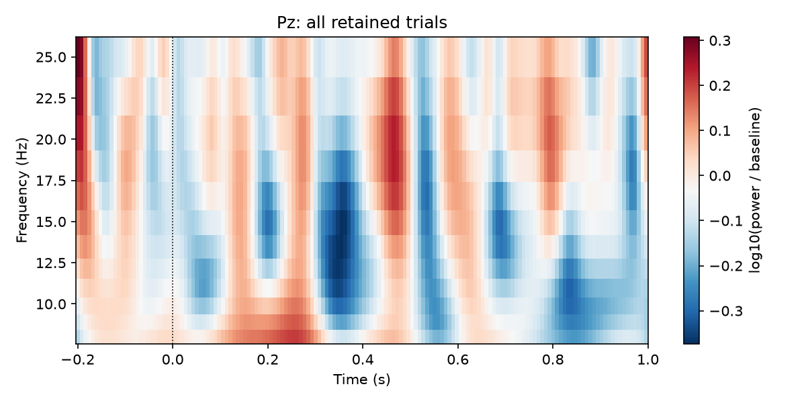

# Further analysis

[Home](../../README.md) · [中文](../zh-CN/analysis.md) · [Usage](usage.md) · [Results](results.md)

Start from an accepted run and keep its report, actual parameters and exclusion decisions with the analysis. The examples below illustrate MNE operations; choose frequencies, electrodes, time windows and statistical contrasts from the study design. Processing completion does not determine whether a recording answers the research question.

## Choose the output and analysis settings

| Aim | Starting data | Main decisions |
|---|---|---|
| Resting PSD / band power | Accepted continuous FIF or fixed epochs | State, effective duration, BAD rejection, window length, spectral estimator and reference |
| ERP | Accepted event-locked epoch FIF | Event definition, latency correction, baseline, ROI/time window, condition retention |
| Time-frequency power | Longer event epochs with suitable filter bandwidth | Padding, frequencies/cycles, baseline transform and induced/evoked definition |
| Connectivity | Accepted stationary segments or task-specific epochs | Reference, sensor mixing, estimator, number/duration of segments, spatial model |
| Source analysis | Accepted MNE data plus head model/locations | Digitization, coregistration, reference, rank and covariance model |
| Group statistics / decoding | Per-subject outputs/features | Independent unit, missing data, multiple comparisons and validation split |

Keep preprocessing consistent within the planned comparison. If two settings are scientifically plausible, define a small sensitivity analysis and compare conclusions; do not choose the setting that produces the strongest desired effect.

## Resting-state power spectrum and band power

This example uses non-overlapping 4-second epochs and excludes all continuous BAD intervals. Welch power is returned in V²/Hz. Integrating across a band gives V²; multiply by `1e12` for µV². Average or summarize within subjects before group inference.

```python
import mne
import numpy as np
from scipy.integrate import trapezoid

raw = mne.io.read_raw_fif("outputs/sub01_rest/sub01_cont_raw.fif", preload=False)
epochs = mne.make_fixed_length_epochs(
    raw, duration=4.0, overlap=0.0, preload=True,
    reject_by_annotation=True,
)
if len(epochs) == 0:
    raise RuntimeError("No accepted 4-second windows remain")

n_fft = int(round(4.0 * epochs.info["sfreq"]))
spectrum = epochs.compute_psd(
    method="welch", fmin=1.0, fmax=40.0, picks="eeg",
    n_fft=n_fft, n_per_seg=n_fft, n_overlap=0,
)
power, frequencies = spectrum.get_data(return_freqs=True)
alpha = (frequencies >= 8.0) & (frequencies <= 13.0)
broad = (frequencies >= 1.0) & (frequencies <= 40.0)
alpha_uv2 = trapezoid(power[..., alpha], frequencies[alpha], axis=-1) * 1e12
total_uv2 = trapezoid(power[..., broad], frequencies[broad], axis=-1) * 1e12
relative_alpha = np.divide(alpha_uv2, total_uv2,
                           out=np.full_like(alpha_uv2, np.nan), where=total_uv2 > 0)
print("Retained seconds:", len(epochs) * 4.0)
print("Channel-wise median alpha power (µV²):", np.median(alpha_uv2, axis=0))
print("Channel-wise median relative alpha:", np.nanmedian(relative_alpha, axis=0))
spectrum.plot(average=True)
```

The denominator defines what “relative alpha” means: changing 1–40 Hz to another range changes the measure. Longer windows improve frequency resolution but may retain fewer artifact-free segments. Retention, stationarity and spectral precision should be evaluated together. MNE's [Spectrum tutorial](https://mne.tools/stable/auto_tutorials/time-freq/10_spectrum_class.html) explains spectral objects and estimators.

If you compute PSD directly on Raw, explicitly choose `reject_by_annotation=True` and compatible estimator settings. Never concatenate noncontiguous good samples into a fake continuous trace for filtering or ordinary FFT analysis: that introduces artificial discontinuities.

## ERP inspection and measurement

Use the exported epochs to preserve the event-window QC decisions. Recreating ordinary `mne.Epochs` from the continuous output can reject a different trial set because its default annotation policy includes newly generated continuous BAD.

```python
import mne
import numpy as np

epochs = mne.read_epochs("outputs/sub01_oddball/sub01_clean-epo.fif", preload=True)
conditions = ["standard", "target"]
for name in conditions:
    if name not in epochs.event_id or len(epochs[name]) == 0:
        raise RuntimeError(f"No retained trials for {name}")
print({name: len(epochs[name]) for name in conditions})

evokeds = {name: epochs[name].average(picks="eeg") for name in conditions}
mne.viz.plot_compare_evokeds(evokeds, picks=["Cz", "Pz"], combine="mean")
difference = mne.combine_evoked([evokeds["target"], evokeds["standard"]], weights=[1, -1])

# Illustration only: choose a study-defined ROI and latency interval.
roi = ["Cz", "Pz"]
interval = (difference.times >= 0.30) & (difference.times <= 0.60)
mean_difference_uv = difference.get_data(picks=roi)[:, interval].mean() * 1e6
print("Target-minus-standard ROI mean (µV):", mean_difference_uv)
```

Mean amplitude over a preselected interval is often easier to compare reproducibly than selecting each subject's largest peak. The illustrated 300–600 ms interval is not a universal P300 definition. Inspect baseline, single-trial distributions, latency alignment, scalp distribution and each condition's sample size. See [MNE's ERP tutorial](https://mne.tools/stable/auto_tutorials/evoked/30_eeg_erp.html) and [epoch visualization](https://mne.tools/stable/auto_tutorials/epochs/20_visualize_epochs.html).

Unequal trial counts imply unequal precision. Do not automatically discard trials merely to force equality for every analysis; decide whether balancing is required by the estimator or experimental contrast, and report any subsampling seed. Do not reapply a different baseline casually to already baseline-corrected epochs; document the original correction.

## Time-frequency analysis

The default −0.2…1.0 s ERP epoch is often too short for low-frequency wavelets and a baseline well separated from the edges. Request longer epochs during preprocessing, and ensure the recording and intertrial structure support those windows:

```python
import mne
import numpy as np
from eegproc import run

raw = mne.io.read_raw_fif("prepared/sub01_task_raw.fif", preload=False)
events, _ = mne.events_from_annotations(raw, event_id={"1": 1, "2": 2})
result = run(
    raw, "outputs/sub01_tfr", "sub01", purpose="erp", task_name="oddball",
    events=events, event_id={"standard": 1, "target": 2},
    epoch_tmin=-1.5, epoch_tmax=2.0, epoch_baseline=None,
)
epochs = mne.read_epochs(result.outputs["epochs"], preload=True)
frequencies = np.arange(4.0, 26.0)
power = epochs["target"].compute_tfr(
    method="morlet", freqs=frequencies, n_cycles=frequencies / 2.0,
    picks="eeg", average=True, return_itc=False, n_jobs=1,
)
power.apply_baseline((-0.8, -0.3), mode="logratio")
power.crop(tmin=-0.8, tmax=1.0)
power.plot(picks=["Cz"])
```

Here frequencies remain below the 30 Hz analysis low-pass. The cycle schedule, padding and baseline are example choices, not pipeline defaults. This averages **single-trial power**; it includes evoked and non-phase-locked contributions. Power of the averaged ERP is a different quantity. Plan induced-power estimation explicitly when that is the target. The MNE [frequency/time-frequency tutorial](https://mne.tools/stable/auto_tutorials/time-freq/20_sensors_time_frequency.html) describes the relevant representations.



This separate [script example](../../examples/analyze_outputs.py) averages all retained synthetic trials at Pz and displays log10 power relative to baseline. It uses the short default ERP epochs and is a plotting demonstration: edge effects and its short baseline limit interpretation. Use padded epochs such as the code above for a planned time-frequency analysis. It is not a target-versus-standard contrast or a validation of neural recovery.

## Connectivity and source analysis

MNE-Connectivity is a separate downstream package, not an eegproc runtime dependency. In an analysis environment, the user may install a chosen compatible release, then use accepted EEG epochs:

```python
# Requires a separately installed mne-connectivity version supporting this API.
from mne_connectivity import spectral_connectivity_epochs

connectivity = spectral_connectivity_epochs(
    epochs.copy().pick("eeg"),
    method="wpli2_debiased", mode="multitaper",
    fmin=8.0, fmax=13.0, faverage=True, n_jobs=1,
)
matrix = connectivity.get_data(output="dense")
```

Here `epochs` must be the intended accepted segments, for example the resting epochs above, rather than an unrelated condition left in a notebook variable. Require enough stationary segments; changing their duration changes the spectral estimate. The [official connectivity API](https://mne.tools/mne-connectivity/stable/generated/mne_connectivity.spectral_connectivity_epochs.html) describes assumptions and supported measures. Sensor connectivity remains affected by mixing/reference choices, and a phase-lag measure does not establish anatomical or causal connectivity.

For source analysis, preserve genuine electrode positions, account for average-reference/interpolation rank, and construct a suitable head model, transform and noise covariance. Template coordinates are not equivalent to individual digitization. These inputs are outside this preprocessing package; see [MNE forward modeling](https://mne.tools/stable/auto_tutorials/forward/30_forward.html).

## Group statistics and decoding

For a within-subject contrast, first compute each participant's condition difference on aligned channels and times. A one-sample permutation test on subject differences preserves the paired design; treating thousands of trials as independent subjects does not. Predefine the electrode/time/frequency search space and multiplicity strategy. Cluster significance supports a cluster-level result, not precise onset or significance at every included sample. See [MNE statistical inference](https://mne.tools/stable/auto_tutorials/stats-sensor-space/10_background_stats.html) and the [one-sample cluster API](https://mne.tools/stable/generated/mne.stats.permutation_cluster_1samp_test.html).

For decoding, split by the intended generalization unit, such as participant or session. Fit feature selection, scaling and learned transforms within the appropriate training folds. Whole-recording preprocessing is not automatically leakage-free for every predictive claim; align preprocessing and validation with the prospective deployment setting. Report excluded participants, missing conditions, duration/trial distributions and any parameter sensitivity analyses.

## If the target filter band changes

The pipeline computes a common band spanning analysis and ICA training bands, applies ASR there, and then produces the required analysis/training branches. Thus changing the analysis band can affect more than the final picture:

- If the common band stays the same, ASR and the ICA training input may stay comparable, while final waveform amplitudes, residual QC and epoch retention can still change.
- If the common band expands or its lower edge changes, ASR calibration/reconstruction and later ICA can also change.
- Making both bands 1–100 Hz saves a full-record branch but removes the ERP analysis protection provided by a lower high-pass. A lower simulated aggregate error elsewhere does not guarantee preserved slow ERP components.
- Raising the low-pass to study gamma retains additional muscle/line-related activity; lowering it makes that frequency range unavailable for later analysis.

For slow ERP components, evaluate waveform shape and baseline/latency effects before increasing high-pass. For spectral analyses, assess attenuation near filter transitions rather than treating cutoffs as perfectly sharp boundaries. Once frequencies are removed, later filtering cannot recover them. MNE's [filtering background](https://mne.tools/stable/auto_tutorials/preprocessing/25_background_filtering.html) explains ringing, transitions and distortion.

Compare candidate settings on the **same input, event list, seeds and declared QC rules**. Track retained duration/trials, regional bad-channel burden, residual artifacts and the scientific outcome together. Retain both reports and designate one primary configuration before group hypothesis testing.
