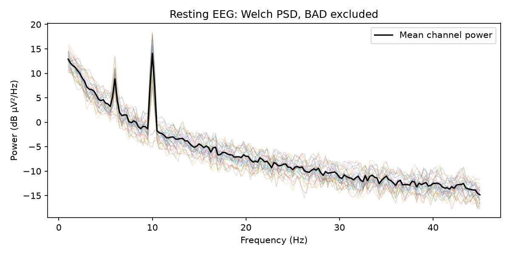
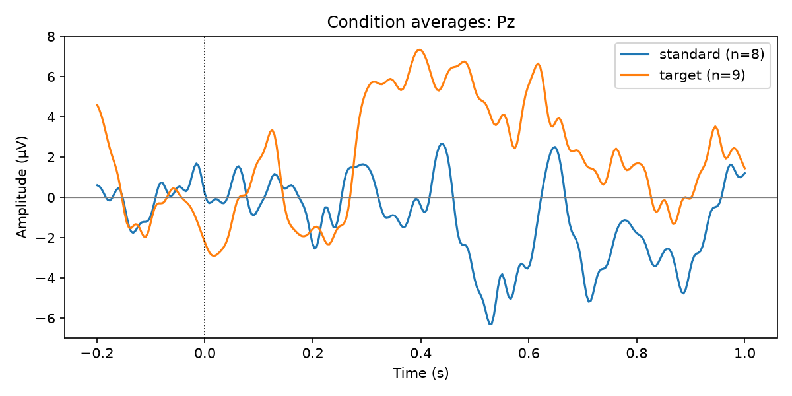

# Interpreting results

[Home](../../README.md) · [中文](../zh-CN/results.md) · [Usage](usage.md) · [Further analysis](analysis.md)

## Files and processing status

With ICA enabled, an ordinary completed run normally creates six files:

```text
outputs/sub01/
├── sub01_cont_raw.fif          Continuous cleaned data, including original auxiliary channels
├── sub01-ica.fif               ICA model with the final exclusion list
├── sub01_report.html           Standalone report, figures, tables, parameters and provenance
└── sub01_ica_review/
    ├── pre_ica_raw.fif         Analysis-band data before IC subtraction, in the MNE container
    ├── decomposition-ica.fif   Frozen decomposition with exclude=[]
    └── checkpoint.json        Config, events, input identity, diagnostics and continuation state
```

Optional retained epochs add `sub01_clean-epo.fif`. If all trials are rejected, no empty epoch FIF is written. Review mode produces the HTML and three checkpoint files; it has not yet produced a final cleaned recording. ICA-disabled runs produce neither ICA model nor checkpoint. Continuation reuses the parent checkpoint and writes a new result family. Large FIF files may split into numbered parts; retain every part in the output inventory.

There is no `original_raw.fif`, `preview_raw.fif`, full training snapshot, or image/table sidecar. Keep the prepared input separately because continuation verifies that input. `pre_ica_raw.fif` is a recovery point **before IC subtraction**, not the unfiltered recording or a copy from before all preprocessing.

| `result.status` / report label | Meaning | Next action |
|---|---|---|
| `completed` / Completed | Processing completed without the workflow's review flags | Inspect the report and apply the study's acceptance criteria. |
| `review_required` / Completed with observations | Data were processed, but quality findings need review | Examine the listed observations; record accept/revise/exclude. |
| `awaiting_ica_review` / Awaiting ICA selection | ICA is fitted, subtraction is pending | Inspect ICs and resume with a complete exclusion list. `result.raw` is `None`. |
| `failed` / Failed | Processing raised an error | Inspect the error/stage; partial artifacts do not establish completion. |

Processing, delivery and report-generation status are also recorded separately. A usable FIF can exist even if a later report or epoch stage fails. A report existing on disk does not guarantee every requested stage completed.

## Read the report in this order

### 1. Summary

Confirm subject, task name, analysis purpose, duration, sampling rate, EEG channel count and analysis/ICA bands. A wrong task label is a metadata issue; a wrong analysis band can change the scientific measurement. Read the **Parameter adjustments** table, especially any changes to filters, epoching, missing optional backends or manual IC lists.

The **Output BAD fraction** measures the proportion of samples covered by the workflow's combined BAD/boundary mask. Overlapping intervals are not double-counted. **Retained seconds** is the corresponding duration outside that mask; it is not the duration of a physically shortened FIF. ICA excluded count measures removed components, not removed channels or a percentage of brain signal. Epoch retention uses the requested/selected input events as its denominator, not every event in the original recording.

The default bad-channel policy is `report`: finish viable processing and report excessive burden for human judgment. The default 30% bad-channel limit and residual amplitude limits are engineering QC settings, not universal biological thresholds. A separate observation is raised when more than 20% of EEG channels require global interpolation. Record the actual burden, location and research consequences instead of automatically accepting a threshold-adjacent recording.

### 2. EEG preprocessing: waveforms and overall PSD

Waveform panels normally use up to three **4-second** windows: a representative amplitude window, the largest input peak-to-peak window, and the largest output peak-to-peak window. Coincident selections can produce fewer panels. These are deliberately targeted samples, not an exhaustive visual audit of the whole recording.

Before/after traces use the same channels and samples. For display, both use the average of originally usable EEG channels and each window has its median removed. This display operation does not change saved data. Yellow shading indicates input BAD, red indicates output BAD, and an asterisk identifies a bad channel. Check whether bursts and steps declined, whether the residual worst window remains problematic, and whether rhythmic/slow activity was plausibly preserved. A flatter trace alone is not evidence of better neural recovery.

The paired overall PSD uses the same input-good channels and time windows. It excludes input BAD windows but intentionally does **not** exclude newly flagged output BAD from just the after trace; otherwise the comparison would also change the sample set. Lines are the median across channels, shading is the interquartile range. Power is shown in dB relative to µV²/Hz. Dashed lines mark analysis filter edges, dotted lines line frequencies.

PSD windows are separate from the 4-second waveform setting. By default their requested duration is `min(20, max(4, 2 / highpass))` seconds: 4 seconds for rest and 20 seconds for ERP, shortened if needed. The **Signal sampling** disclosure records actual windows and frequency resolution. The report PSD is a sampled diagnostic; calculate study PSD on the intended accepted duration for analysis.

### 3. Line-noise removal

This comparison is captured immediately before and after the line-cleaning stage, before band filtering, ASR and ICA. It therefore separates line removal from the later low-pass filter. The same channels and short windows are used in each pair, in the recorded reference.

Each target frequency shows ±5 Hz of spectrum and integrated band power near the target (bins within ±1 Hz). Reduction is calculated per channel as `10*log10(before_power/after_power)` and then summarized by the median. It is not generally the logarithm of the ratio of the two displayed medians.

- Positive reduction: less power in that band after line cleaning.
- Near zero: little measurable change, possibly because little line noise was present.
- Negative reduction or large neighboring changes: inspect the stage and window selection.

Large reduction measures removal around the target; it does not establish that all removed energy was interference. Check adjacent frequencies and any narrow-band neural hypothesis. “Disabled”, “not applied” or “unavailable” is distinct from zero reduction. The method, target frequencies and sampling details are expandable below the figure.

### 4. Channels, annotations and ASR

Use the scalp/channel display and **Channel table** to identify input bad channels, automatically detected channels, interpolation and remaining bad status. A cluster of neighboring bad electrodes can compromise a local effect despite a modest overall fraction. Interpolation estimates missing signals from neighbors; it does not add independent spatial information, and the resulting rank matters for later source/covariance analysis.

The annotation timeline and table show where exclusions occur. **ASR and channel detection** contains backend diagnostics, reference/calibration information, segment handling and processing flags. ASR changes large transient subspaces rather than deleting continuous samples. A large corrected fraction is a prompt to review waveforms and the reference data; it is not a direct percentage of artifact removed or brain signal lost.

### 5. ICA

All fitted components are shown in a dense grid with topography and PSD underneath. **Red component text means the component was excluded in the saved result.** Pending review labels describe a decomposition not yet applied. Clicking a map opens activation, all seven class probabilities and the automatic proposal. The probability/decision table distinguishes the automatic proposal from the final choice.

Inspect candidate eye components for frontal maps and blink/saccade-like activity; muscle candidates for focal/peripheral maps and broadband high-frequency power; line-noise candidates for narrow spectral peaks; heart candidates for rhythmic activity and the recorded ECG support decision. These are review cues, not a replacement classifier. IC activation and PSD use arbitrary component units; topographies are normalized per component and cannot be used to compare absolute amplitudes across ICs.

Also inspect rank, iterations, iteration-limit observations and available training samples relative to rank squared. A convincing class label does not repair an unstable decomposition. The displayed PSD/activation is a bounded training preview, not a complete recording of component activity.

The **Exclude** checkboxes, including those in details, define the *next* exclusion list. Editing them does not change the red labels or plots describing the saved result. Download the selection and [resume from the checkpoint](usage.md#ica-review-and-continuation) to apply it.

### 6. Epochs

The bar plot and table show each condition's input count, annotation/boundary rejections, additional QC rejections and retained count. The detailed event table lists original event index/sample, condition and rejection reason. Compare conditions and participants: unequal loss can create differential precision or selection bias even when total retention looks good.

Event-window QC preserves input manual BAD and tests the actual requested event window after setting aside only newly generated `BAD_residual`. Fixed-window/default annotation QC instead uses the continuous BAD decision. Optional local repair is reported separately and changes epochs only. Review retention together with ERP shape and residual artifacts; maximizing trial count is not the sole objective.

### 7. Methods, References and About

**Methods** describes the effective run. **References** lists the implemented methods. **About** includes stage execution, complete effective parameters, metadata checks, software versions, source hashes, input/output inventory and logs. Use these records when documenting a study or comparing reruns. Metadata differences expected from processing, such as filter information or interpolation-related bad status, must be distinguished from unexpected timing, channel-type or auxiliary-signal changes.

## What does continuous BAD do?

`BAD_residual` is an annotation marking a time interval with residual problems. It does **not** delete samples, set them to zero, or apply another denoising transform. Time, sample indices and auxiliary data remain aligned.

Downstream MNE routines decide how to use these labels. Ordinary `mne.Epochs(..., reject_by_annotation=True)` rejects trials overlapping BAD; it does not invoke eegproc's event-window reevaluation. Explicitly pass the intended annotation policy to downstream PSD/epoch functions. MNE documents this behavior in [Epochs](https://mne.tools/stable/generated/mne.Epochs.html).

For example, continuous BAD might cover 10.0–11.5 s after window/guard expansion. An event epoch at 9.6–10.8 s overlaps it and is rejected by ordinary annotation-based epoching. eegproc event-window QC instead checks that exact epoch if the only conflicting label was newly generated `BAD_residual`. If the overlap is with an original manual BAD, the trial remains excluded. New epoch decisions do not erase continuous annotations.

## Human acceptance record

For each recording, document **accept**, **revise**, or **exclude**, with reviewer and reason. Prioritize:

1. Acquisition/metadata or event timing errors, clipping, and discontinuities.
2. Residual worst-case bursts, implausible amplitude suppression, and distortion near the scientific band.
3. Dense/local bad-channel clusters, excessive ASR intervention or unstable ICA.
4. Ambiguous or mixed ICs and class/ECG disagreements.
5. Too few retained trials, condition-dependent losses and unsuitable baseline/epoch windows.
6. Unexpected metadata audit failures or skipped requested stages.

A suggested record is `subject, task_name, decision, reviewer, reason, accepted_report, accepted_output, excluded_conditions`. Define study-level duration/trial requirements before comparing experimental outcomes.

## Read embedded diagnostics programmatically

During the run, use `result.report`. A saved report embeds the same run record, without needing a JSON sidecar. This standard-library example reads it:

```python
from html.parser import HTMLParser
from pathlib import Path
import json

class RunRecordParser(HTMLParser):
    def __init__(self):
        super().__init__()
        self.active = False
        self.parts = []
    def handle_starttag(self, tag, attrs):
        if tag == "script" and dict(attrs).get("id") == "run-record":
            self.active = True
    def handle_endtag(self, tag):
        if tag == "script":
            self.active = False
    def handle_data(self, data):
        if self.active:
            self.parts.append(data)

parser = RunRecordParser()
parser.feed(Path("outputs/sub01/sub01_report.html").read_text(encoding="utf-8"))
record = json.loads("".join(parser.parts))
print(record["status"], record.get("quality"))
print(record.get("parameter_adjustments", []))
```

Reports contain recording labels, source paths and acquisition metadata. Review those fields before distributing a participant report publicly.

## Synthetic example

These figures were generated by the included [synthetic demo](../../examples/synthetic_demo.py) and [analysis script](../../examples/analyze_outputs.py), using generated signals rather than participant data. In the observed local example, ERP retained 17 of 18 events: standard 8/9 and target 9/9. A manual BAD annotation was deliberately included. This demonstrates file handling and trial accounting; it is not a denoising benchmark or evidence of biological effect size.



The PSD example has visible simulated oscillatory peaks. The thin curves are individual channels and the black curve summarizes mean channel power. This downstream figure differs from the report's paired before/after channel-median PSD.



The ERP example shows Pz means and retained counts for both conditions. Different count and waveform shapes should be reported together; the plotted difference alone does not quantify recovery from a known clean ground truth.
