# Processing workflow

[Home](../../README.md) · [中文](../zh-CN/workflow.md) · [Usage](usage.md) · [Parameters](parameters.md) · [Results](results.md)

These diagrams follow `engine.py`, `stages.py`, `signal_ops.py`, `review.py` and `delivery.py`. `purpose` selects parameter defaults; all purposes use the same stage order. `task_name` is descriptive metadata.

| Standard defaults | Rest | ERP |
|---|---|---|
| Analysis band | 0.5–80 Hz | 0.1–30 Hz |
| ICA training band | 1–100 Hz | 1–100 Hz |
| ASR | Enabled, cutoff 20 | Enabled, cutoff 20 |
| ICA / automatic rule | Picard / `threshold` | Picard / `threshold` |
| Epoch export | Requested separately | Requested separately |

## Main processing sequence

### 1. Input preparation and validation

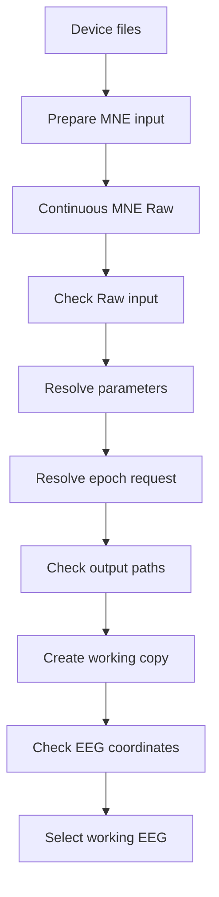

Preparation is a separate script. The input carries calibrated SI units, channel types, montage, timing, annotations and events; auxiliary samples remain in the original MNE container.

### 2. Line noise and channel cleaning

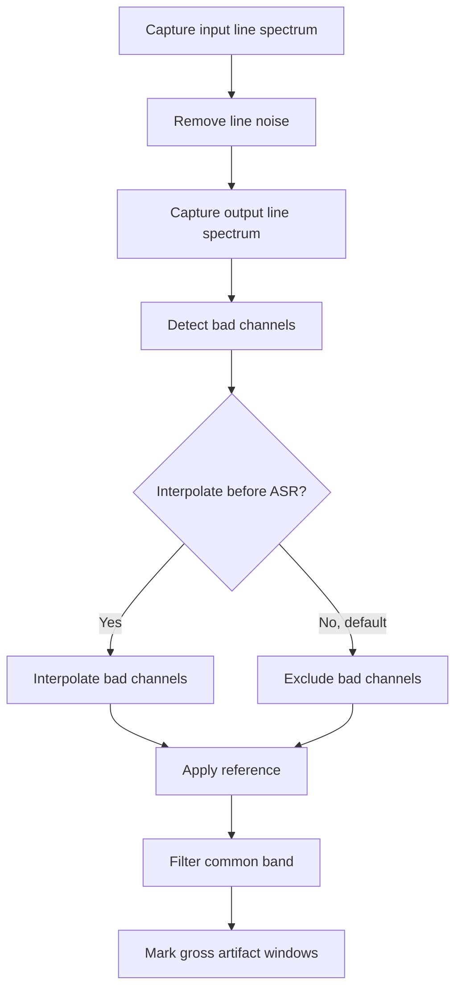

Bad-channel detection uses a temporary training-band signal. The gross-artifact mask is measured before ASR and is used for ICA training exclusion.

### 3. ASR and band preparation

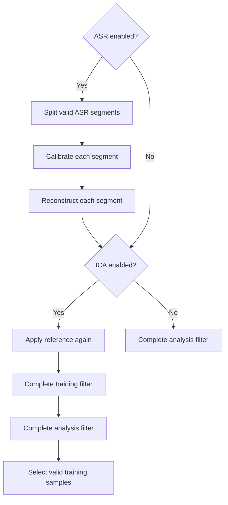

With ICA enabled, continue to stage 4. With ICA disabled, continue directly to stage 6. Band preparation only applies additional required filter edges; identical analysis and training bands share the full-record buffer.

### 4. ICA decomposition and automatic proposal

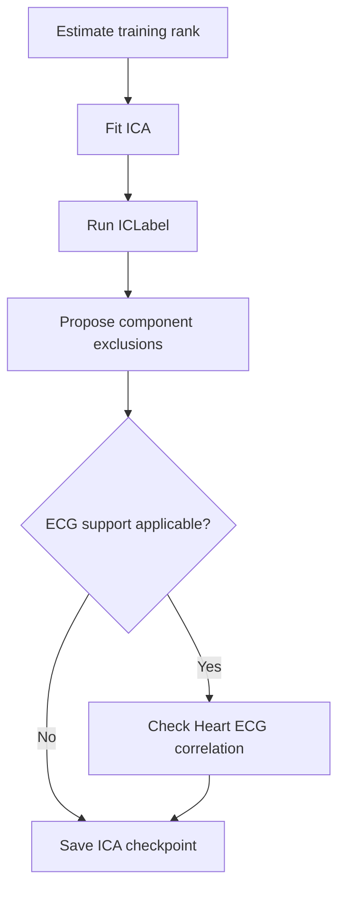

ECG support applies to Heart-only candidates under the `threshold` rule when usable ECG exists. Its reference is prepared from the matching valid training samples before ICA fitting. Without usable ECG, ICLabel alone determines the automatic proposal. The checkpoint contains untouched analysis-band data and a frozen decomposition.

### 5. Component selection

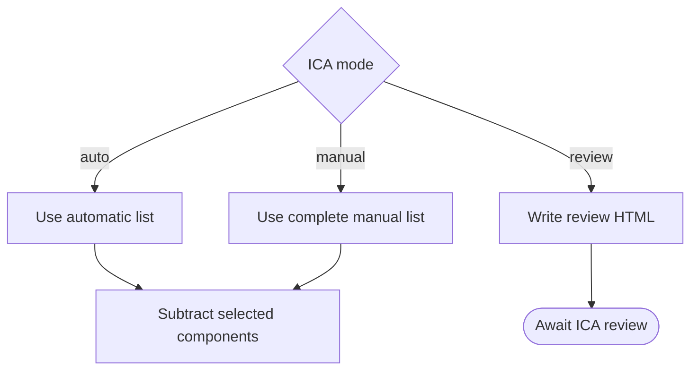

Automatic and manual modes continue to stage 6. Review mode returns `awaiting_ica_review` with `result.raw is None`; use the continuation workflow below.

### 6. Continuous data delivery

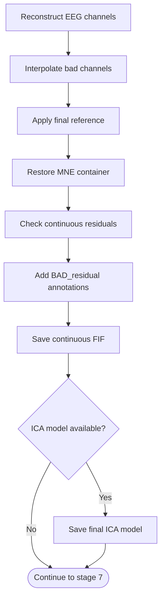

Interpolation, reference and residual annotation follow their respective switches. Reconstruction preserves original auxiliary channels and MNE metadata; continuous QC retains all samples.

### 7. Optional epochs and report

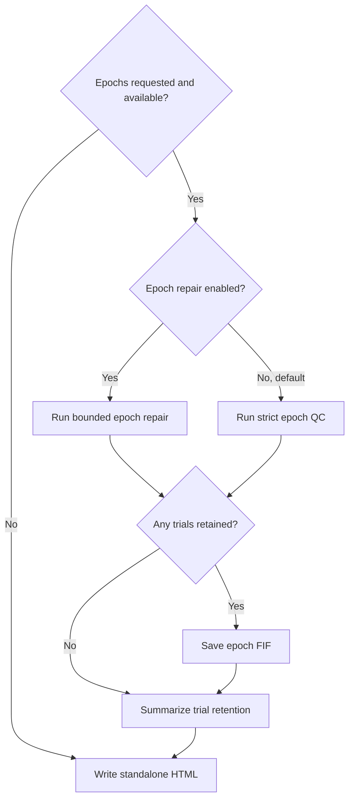

With `epoch_qc="auto"`, event epochs use actual event-window QC and fixed epochs use continuous annotation rejection. Bounded repair is an alternative epoch path. Both preserve input BAD; the report includes per-condition retention and rejection reasons.

- The standard common band is **0.5–100 Hz for rest** and **0.1–100 Hz for ERP**. Line cleaning occurs before this filter and before ASR, not only on the final low-pass output.
- If analysis and ICA training bands are identical, for example **1–100 Hz**, they share the full-record band buffer. Selecting valid training samples and numerical algorithm work can still require other arrays.
- ASR never calibrates or carries state across input BAD/boundary spans. Segments shorter than the configured minimum are skipped and reported. `asr_cutoff=None` bypasses ASR.
- Each eligible ASR segment independently selects reference data, calibrates and reconstructs. The default segment minimum is 20 seconds. The gross-artifact mask is for later ICA training exclusion, not an additional ASR exclusion mask.
- Bad-channel detection uses a temporary training-band copy without input BAD/boundary samples. ICA training retains valid subsegments of at least 1 second and requires at least 20 seconds in total by default. Its bounded diagnostic preview remains in memory, not another Raw file.
- Optional `interpolate_before_asr=True` changes the bad-channel handling at that point. Reference/interpolation switches remain effective; `reference="unchanged"` also prevents reference changes at the final stage.
- With the default `threshold` rule, Heart-only ICLabel candidates require ECG correlation when usable ECG exists; otherwise ICLabel alone is used. `class_max` uses the original category rule without ECG assistance.
- Event-window QC preserves all input BAD annotations, including manual labels and any pre-existing `BAD_residual`. It reevaluates only `BAD_residual` added by this run on the actual requested trial. The continuous output keeps those annotations. Optional bounded epoch repair changes epochs only.

The default QC policy reports quality concerns and finishes viable processing for manual acceptance. `purpose="erp"` alone does not request epochs. Missing optional events can skip epoch export while continuous processing completes.

## ICA review and continuation

### Review the selection

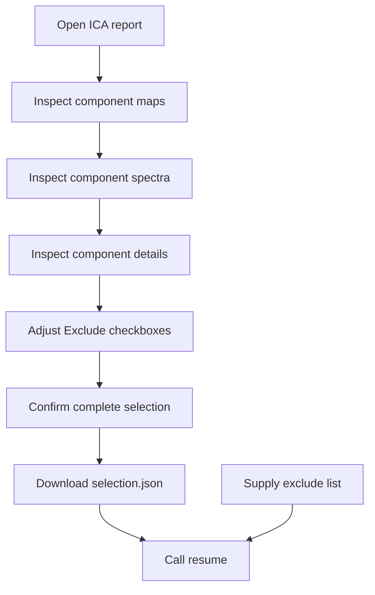

Use the review HTML either before initial subtraction or after an automatic/manual run. Exclude checkboxes are available on each component tile and inside its detail view. The downloaded JSON and `exclude=[...]` are alternative inputs; indices start at zero, and `exclude=[]` keeps every component.

### Resume from the checkpoint

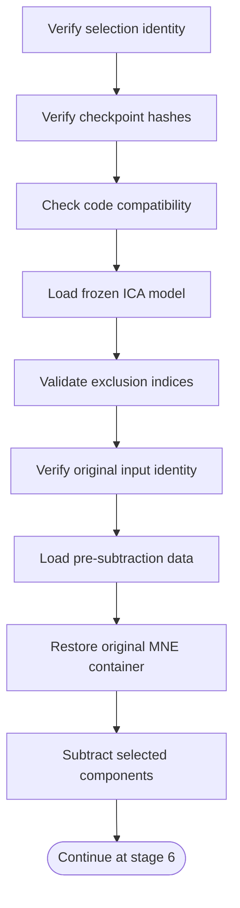

Provide the original prepared FIF or the unchanged original Raw. Compatibility checks include the computation source and dependencies. Resume requires a separate output directory. The new list replaces the previous decision, so previously removed components omitted from the list are restored.

Continuation reuses filtering, ASR, the ICA fit and ICLabel results. It reuses the parent checkpoint rather than writing another full copy. Checkbox edits alone do not modify saved FIFs; the original report's labels and plots describe its saved result until a new run is created.

## Standalone epoching

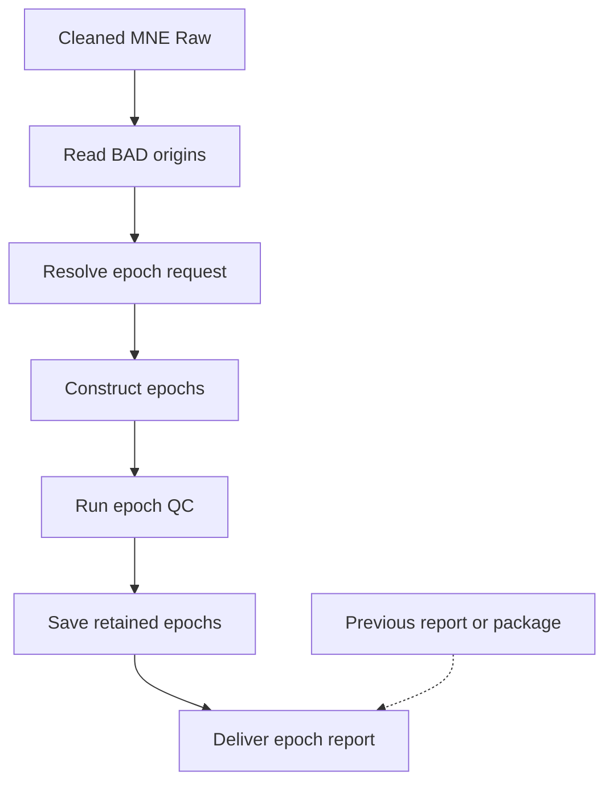

`epoch()` uses the same epoch kernel as stage 7. It does not repeat line cleaning, channel detection, filters, ASR or ICA. The cleaned Raw/FIF carries the global bad-channel list, relevant epoch defaults and minimal automatic-residual origins. Existing, manual and unknown BAD remain protected. The source Raw is unchanged; only the Epochs receive baseline correction or optional bounded repair.

The source report is optional and supplies presentation material, not BAD decisions or required original data. An explicit source takes priority over a same-directory HTML/package and the Raw's report-path hint. Missing or unreadable sources warn and produce an independent epoch report. Choose the correct source yourself; no recording-identity matching is added. New combined HTML keeps the original report by default.

## Immediate or delayed report delivery

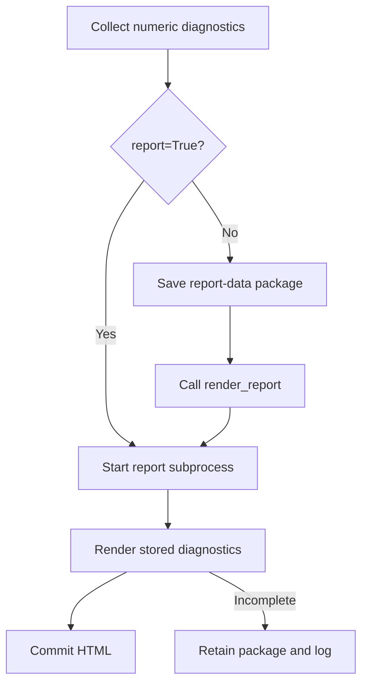

`run()`, `epoch()` and `resume()` default to immediate HTML through a fresh report subprocess. The data-processing caller first collects bounded numeric material without actively importing Agg or font-rendering components; MNE itself may import Matplotlib. `report=False` saves one `*_report_data.npz`, with no drawing or HTML. Representative before/after windows, spectrum summaries, ICA diagnostics and QC records are retained; a full original Raw is not copied. Rendering does not rerun denoising or epoch QC. Existing HTML reuses embedded figures in the same isolated path. A complete immediate report removes temporary material; partial or failed rendering retains a compact package and log. Report status is independent of processing status. Scientific defaults and the four-second waveform display window are unchanged.

## Input and delivered files

### Result files

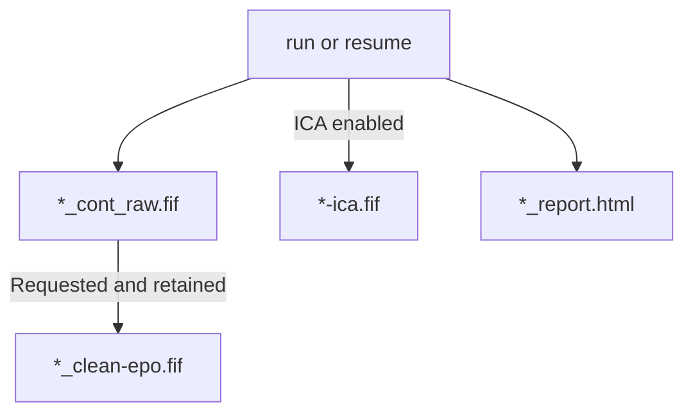

The continuous FIF contains cleaned EEG and original auxiliaries. The final ICA model includes the applied exclusion list. The HTML embeds all report figures, tables, effective settings and provenance.

### ICA checkpoint files

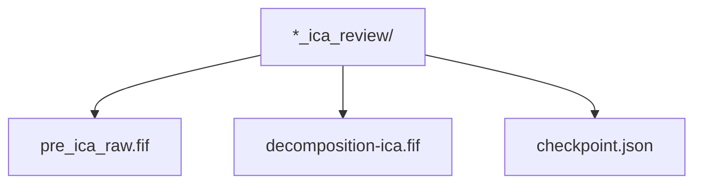

`pre_ica_raw.fif` contains the analysis-band signal before IC subtraction. `decomposition-ica.fif` is the frozen model; `checkpoint.json` records continuation settings, identity checks and report data.

The normal ICA run with a completed report contains **six files**: three result files and the three-file checkpoint. Partial or failed rendering additionally retains compact report material and an error log for retry. Retained epochs add one file. With `report=False`, the report-data package replaces the immediate HTML. Review-only mode creates the report or deferred package plus the checkpoint; ICA-disabled runs have neither model nor checkpoint. Standalone epoching writes retained epoch FIF and one HTML or package, without a continuous-data or ICA copy. Large FIFs may have numbered parts. No `original_raw.fif`, `preview_raw.fif`, stage-by-stage snapshots, or report image/table attachments are generated. The optional `selection.json` is downloaded by the reviewer.
