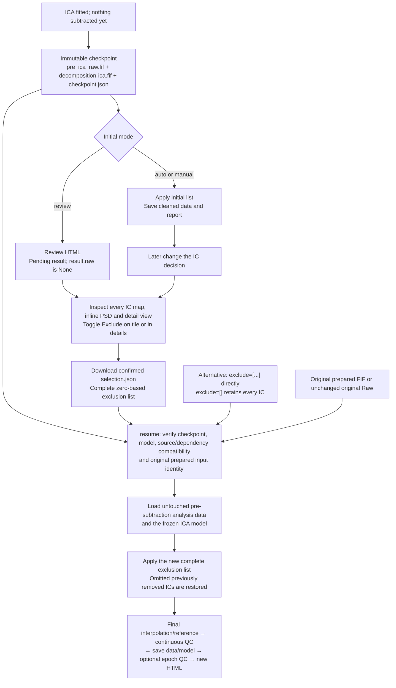
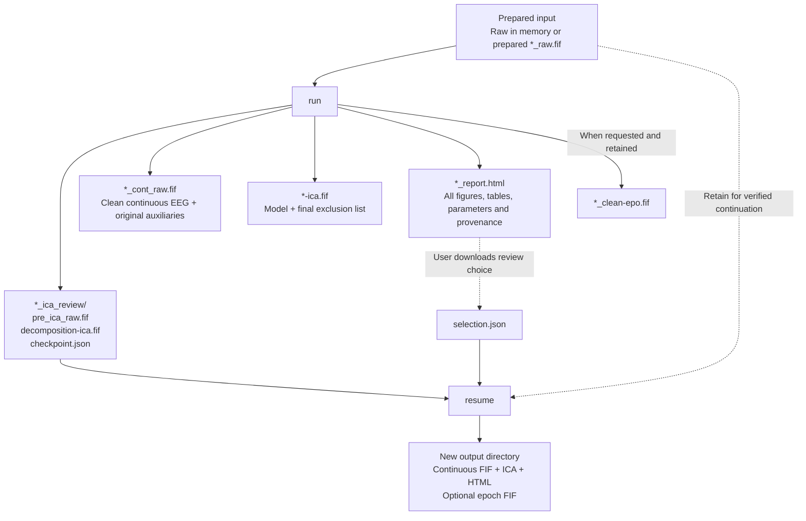

# Processing workflow

[Home](../../README.md) · [中文](../zh-CN/workflow.md) · [Usage](usage.md) · [Parameters](parameters.md) · [Results](results.md)

These diagrams follow `engine.py`, `stages.py`, `signal_ops.py`, `review.py` and `delivery.py`. `purpose` selects parameter defaults; all purposes use the same stage order. `task_name` is descriptive metadata.

| Standard defaults | Rest | ERP |
|---|---|---|
| Analysis band | 0.5–80 Hz | 0.1–30 Hz |
| ICA training band | 1–100 Hz | 1–100 Hz |
| ASR | Enabled, cutoff 20 | Enabled, cutoff 20 |
| ICA / automatic rule | Picard / `threshold` | Picard / `threshold` |
| Epoch export | Requested separately | Requested separately |

## Main processing sequence

```mermaid
flowchart TB
    accTitle: EEG processing stages
    accDescr: Top-down sequence of processing, review decisions, or delivered files.
    DEV["Device files"] --> PREP["Separate preparation<br/>Read calibration, channel types, montage and events"]
    PREP --> RAW["Continuous MNE Raw<br/>SI units, native timing, annotations and auxiliary channels"]
    RAW --> RES["Resolve parameters and optional event request<br/>Check input, coordinates and output collisions"]
    RES --> EEG["Working copy: select EEG<br/>Keep original input and auxiliary samples intact"]
    EEG --> LINE["Line-noise cleaning<br/>Capture paired spectra immediately before and after"]
    LINE --> CH["Detect bad channels on a temporary training-band signal<br/>Default: exclude from working EEG; interpolate at the end"]
    CH --> COMMON["Reference and common-band filter<br/>Common low = min of both high-pass edges<br/>Common high = max of both low-pass edges"]
    COMMON --> GROSS["Measure gross-artifact windows before ASR<br/>Default: exclude these windows from ICA training"]
    GROSS --> ASR["ASR: enabled by default for rest and ERP, cutoff 20<br/>Process uninterrupted valid segments separately"]
    ASR --> ENABLED{"ICA enabled?"}
    ENABLED -->|Yes| BRANCH["Reference again; create analysis and training bands<br/>Filter only additional required edges"]
    BRANCH --> ANA["Analysis signal<br/>Rest: 0.5–80 Hz<br/>ERP: 0.1–30 Hz"]
    BRANCH --> TRAIN["ICA training signal: 1–100 Hz<br/>Exclude input BAD, boundaries and gross windows"]
    TRAIN --> ICA["Rank estimate → Picard ICA → ICLabel<br/>Threshold rule: usable ECG supports Heart candidates"]
    ANA --> CP["Save pre-subtraction checkpoint<br/>Analysis data + frozen ICA + continuation record"]
    ICA --> CP
    CP --> SELECT{"ICA mode"}
    SELECT -->|auto| AUTO["Use automatic exclusion proposal"]
    SELECT -->|manual| MANUAL["Use supplied complete exclusion list"]
    SELECT -->|review| PAUSE["Write review HTML and return awaiting_ica_review<br/>Continue through the review workflow below"]
    AUTO --> APPLY["Subtract selected ICs from analysis signal"]
    MANUAL --> APPLY
    ENABLED -->|No| NOICA["Apply any remaining analysis-band filter"]
    APPLY --> FINAL["Reconstruct EEG channels<br/>Final interpolation and reference as configured"]
    NOICA --> FINAL
    FINAL --> QC["Continuous residual QC<br/>Add BAD_residual annotations; retain all samples"]
    QC --> SAVE["Save continuous FIF and final ICA model when available"]
    SAVE --> EPOCH{"Epochs requested and events/windows available?"}
    EPOCH -->|No| HTML["Write standalone HTML<br/>Effective settings, plots, QC, methods and provenance"]
    EPOCH -->|Yes| EQC["Epoch QC; preserve input manual BAD<br/>Events + auto: actual event-window screen<br/>Fixed + auto: continuous annotation rejection"]
    EQC --> EP["Save epoch FIF only if trials remain<br/>Report per-condition retention and rejection reasons"]
    EP --> HTML
```

- The standard common band is **0.5–100 Hz for rest** and **0.1–100 Hz for ERP**. Line cleaning occurs before this filter and before ASR, not only on the final low-pass output.
- If analysis and ICA training bands are identical, for example **1–100 Hz**, they share the full-record band buffer. Selecting valid training samples and numerical algorithm work can still require other arrays.
- ASR never calibrates or carries state across input BAD/boundary spans. Segments shorter than the configured minimum are skipped and reported. `asr_cutoff=None` bypasses ASR.
- Each eligible ASR segment independently selects reference data, calibrates and reconstructs. The default segment minimum is 20 seconds. The gross-artifact mask is for later ICA training exclusion, not an additional ASR exclusion mask.
- Bad-channel detection uses a temporary training-band copy without input BAD/boundary samples. ICA training retains valid subsegments of at least 1 second and requires at least 20 seconds in total by default. Its bounded diagnostic preview remains in memory, not another Raw file.
- Optional `interpolate_before_asr=True` changes the bad-channel handling at that point. Reference/interpolation switches remain effective; `reference="unchanged"` also prevents reference changes at the final stage.
- With the default `threshold` rule, Heart-only ICLabel candidates require ECG correlation when usable ECG exists; otherwise ICLabel alone is used. `class_max` uses the original category rule without ECG assistance.
- Event-window QC preserves all input BAD annotations, including manual labels and any pre-existing `BAD_residual`. It reevaluates only `BAD_residual` added by this run on the actual requested trial. The continuous output keeps those annotations. Optional bounded epoch repair changes epochs only.

The default QC policy reports quality concerns and finishes viable processing for manual acceptance. `purpose="erp"` alone does not request epochs. Missing optional events can skip epoch export while continuous processing completes.

## ICA review and continuation

Continuation reuses filtering, ASR, the ICA fit and ICLabel results. It reuses the parent checkpoint rather than writing another full copy. Checkbox edits alone do not modify saved FIFs; the original report's labels and plots describe its saved result until a new run is created. Use a separate output directory for continuation.

## Input and delivered files

The normal completed ICA run contains **six files**: three result files and the three-file checkpoint. Retained epochs add one file. Review-only mode creates HTML plus the checkpoint; ICA-disabled runs have neither model nor checkpoint. Large FIFs may have numbered parts. No `original_raw.fif`, `preview_raw.fif`, stage-by-stage snapshots, or report image/table attachments are generated. The optional `selection.json` is downloaded by the reviewer.
