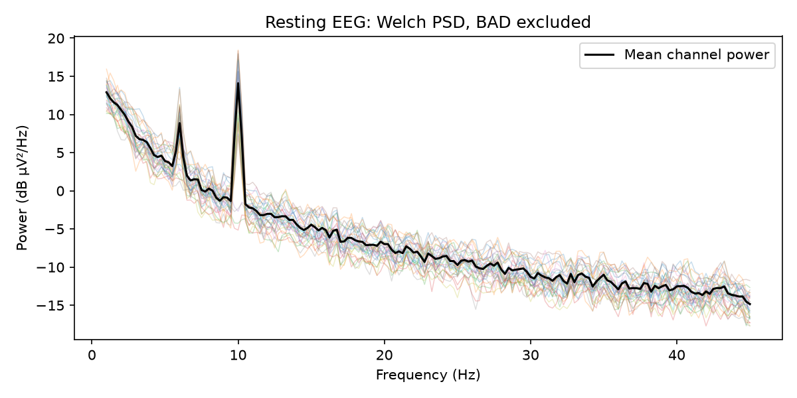
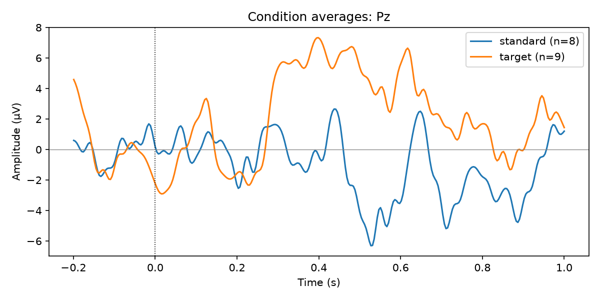

# 结果解读

[首页](../../README.zh-CN.md) · [English](../en/results.md) · [使用示例](usage.md) · [后续分析](analysis.md)

## 输出文件与运行状态

开启 ICA 并正常完成时，通常输出六个文件：

```text
outputs/sub01/
├── sub01_cont_raw.fif          清理后的连续数据，保留原辅助通道
├── sub01-ica.fif               ICA 模型及最终排除列表
├── sub01_report.html           单文件报告，内含图片、表格、参数和来源记录
└── sub01_ica_review/
    ├── pre_ica_raw.fif         分析频段、减除 IC 前的数据及 MNE 容器
    ├── decomposition-ica.fif   冻结分解，exclude=[]
    └── checkpoint.json        参数、事件、输入身份、诊断和续处理状态
```

请求分段且存在保留试次时，另写 `sub01_clean-epo.fif`。全部试次被拒绝时不写空 epochs。review 模式仅输出 HTML 和三个断点文件，尚未形成最终清理数据。关闭 ICA 时不产生 ICA 模型及断点。续处理复用父断点，写新的结果文件。较大 FIF 可能拆成编号分卷，输出清单中的所有分卷都要保留。

`report=False` 时以 `sub01_report_data.npz` 替代即时 HTML，包中保存有限绘图数据和 QC 记录，之后可用 `render_report()` 直接从包中绘制。完整即时报告不保留临时数据包；报告不完整时保留恢复素材和日志。独立分段只输出有保留试次时的 `sub01_clean-epo.fif`，以及一个 HTML 或报告包，不复制连续数据或 ICA 断点。

不生成 `original_raw.fif`、`preview_raw.fif`、全程训练副本或图片/表格附件。准备后的原始输入应另行保留，因为 ICA 续处理会核验它。独立分段只需清理后 Raw/FIF，其中已保存 BAD 来源及原全局坏导名单。`pre_ica_raw.fif` 保存已完成前段处理、**减除 IC 之前**的数据。

| 状态 / 报告文字 | 含义 | 下一步 |
|---|---|---|
| `completed` / Completed | 完成处理，未触发流程中的复核标记 | 仍需读报告，按研究标准判断可用性。 |
| `review_required` / Completed with observations | 已处理，有质量问题需复核 | 查看观察项，记录接受、修改或排除。 |
| `awaiting_ica_review` / Awaiting ICA selection | ICA 已拟合，尚未减除 | 查看成分后续处理；`result.raw` 为 `None`。 |
| `failed` / Failed | 处理抛出异常 | 查看错误和阶段，确认哪些文件已保存。 |

记录中另区分处理、交付和报告生成状态。后续报告或分段失败时，前面成功保存的 FIF 可能仍存在。查看各项状态，确认本次请求的实际完成情况。

`report_status="deferred"` 表示主动延迟报告，可用数据包后续生成 HTML。独立分段没有可用事件时，分段解析状态为跳过；全部试次拒绝时保留数为零，不写分段 FIF。两种情况均在 HTML 或报告包中记录原因。`.epochs` 提供分段结果，`.outputs` 只列实际生成文件。

`report_status` 描述下表中的报告状态。数据可用性由人工复核判断。

| 报告状态 | 含义 | 后续操作 |
|---|---|---|
| `completed` | 所有适用报告内容已生成 | 按研究标准复核数据。 |
| `partial` | 已有 HTML，但存在缺失内容或绘图错误 | 阅读错误项，从保留素材重试。 |
| `failed` | 渲染退出、超时，或 HTML 未能提交 | 使用保留的素材和日志，在新目标重试。 |
| `deferred` | 主动延迟 HTML | 需要时调用 `render_report()`。 |

渲染通过全新子进程执行，最多尝试两次，每次 300 秒。仅渲染失败时，已完成的数据结果仍然可用。报告不完整时保留有限的 `*_report_data.npz` 和 `*_report_errors.log`；完整即时报告会清理临时渲染文件。传给 `render_report()` 的来源包保持不变。`report_execution` 记录尝试和退出码。批量运行另写 `batch_summary.json` 和每份记录的简短 `batch_result.json`，用于记录处理状态及恢复任务。

## 建议按以下顺序读报告

### 1. Summary：先确认记录和实际参数

检查受试者、task_name、分析用途、时长、采样率、EEG 通道数和分析/ICA 频段。任务标签错误属于元数据问题；分析频段错误可能直接改变研究量。阅读 **Parameter adjustments**，尤其关注滤波、分段、缺少可选后端或人工 IC 列表的实际调整。

**Output BAD fraction** 是综合 BAD/边界掩码覆盖的样本比例，重叠区间计一次。**Retained seconds** 是掩码之外的时长，FIF 保留原时长。ICA 删除数量统计减除的成分，与坏导数量或脑信号损失比例属于不同指标。分段保留率以请求并选中的输入事件为分母。

默认坏导策略为 `report`，完成可执行处理并报告过高负担。默认工程质控设置包括 30% 坏导上限和残留幅度阈值。全局插值超过 20% EEG 通道也会记录为观察项。人工判断结合坏导比例、位置和研究问题。

### 2. EEG preprocessing：波形与总体功率谱

波形图默认最多选三个 **4 秒**窗口：代表性幅度窗、输入峰峰值最大的窗，以及输出峰峰值最大的窗。窗口重合时可能少于三幅。这组抽样可用于检查代表性片段及峰峰值最大的片段。

前后使用相同通道和样本。绘图时均按原来可用 EEG 通道的平均值重参考，并去掉各窗口中位数。保存数据保持原样。黄色阴影是输入 BAD，红色是输出 BAD，星号表示坏导。重点看跳变是否减轻、最差输出窗口是否仍异常、节律和慢活动是否保留。判断信号恢复时，同时检查伪迹和所关注的脑活动。

总体 PSD 使用相同的输入有效通道和时间窗。两条曲线均排除输入 BAD，并使用同一组样本。处理后新增的 BAD 不影响这组样本的选择。实线为通道中位数，阴影为四分位范围，单位为相对于 µV²/Hz 的 dB。虚线标分析滤波边界，点线标工频。

PSD 时间窗与波形的 4 秒设置相互独立。默认请求时长为 `min(20, max(4, 2 / highpass))` 秒：默认静息态为 4 秒，ERP 为 20 秒；可用片段不足时会缩短。**Signal sampling** 记录实际时间窗和频率分辨率。报告 PSD 是抽样诊断，正式分析应按规定的有效时长重新计算。

### 3. Line-noise removal：区分去工频和后续低通

此图在工频处理前后立即采集，早于带通滤波、ASR 和 ICA，因此能区分工频步骤与后续低通的贡献。前后使用相同通道和短窗，并保留采集参考。

每个目标频率显示附近 ±5 Hz 的频谱，并积分目标 ±1 Hz 范围内的频率格点功率。每个通道先计算 `10*log10(处理前功率/处理后功率)`，再取通道中位数；因此不一定等于表格中两个功率中位数的比值取对数。

- 正值：该频带功率减少。
- 接近零：可测变化小，也可能原先就没有明显工频。
- 负值或邻频变化过大：检查实际处理和采样窗口。

下降量衡量目标附近减少的总能量，其中也可能包含该频带内的 EEG 信号。结合邻近频率和研究所需窄频带判断。Disabled、not applied、unavailable 与“下降为零”不同。图下可展开方法、目标频率和采样详情。

### 4. Channels、Annotations 与 ASR

通过通道分布图和 **Channel table** 查看输入坏导、自动检出、插值及最终坏导状态。即使总体比例不高，局部相邻坏导簇也可能影响区域效应。插值用邻导估计缺失信号，保留的独立空间信息仍来自实测通道。后续源定位和协方差分析需考虑实际信号秩。

注释时间线和表格说明问题发生在哪里。**ASR and channel detection** 记录后端诊断、参考/校准信息、分段处理和警告。ASR 重建异常瞬态子空间并保留连续采样点。修正比例衡量重建负担。比例较高时，核对波形和参考数据，以评估伪迹减少和脑信号变化。

### 5. ICA：查看全部成分及最终决定

所有拟合成分均以密集地形图排列，PSD 位于图下。**红色成分文字表示保存的结果中已删除该成分。** Pending 表示该分解尚未应用。点击地形图可看激活序列、七类概率及自动建议；概率/决策表区分自动建议与最终决定。

眼动候选可结合额区分布及眨眼/扫视样活动；肌电候选结合周边或局灶分布、高频宽带功率；工频候选看窄频谱峰；心电候选看节律性及实际 ECG 支持记录。这些特征供人工复核。IC 激活和频谱使用任意成分单位，地形图颜色表示各成分归一化后的分布。比较成分时，以图形分布为准。

同时查看秩、迭代次数、是否触及迭代上限、训练样本量相对秩平方的比例。先用这些指标判断 ICA 分解是否稳定，再结合分类概率复核成分。图中的成分 PSD 和激活取自有限训练预览。

卡片和详情中的 **Exclude** 用于设定下一次排除列表。红字和波形记录本次保存结果。下载选择文件并[从断点续处理](usage.md)可生成新结果。

### 6. Epochs：看各条件损失，而不只看总保留率

柱图和表格分别列出条件输入数、注释/边界拒绝、额外 QC 拒绝及最终保留数。详细事件表保留原事件索引、样本点、条件和拒绝原因。比较条件及受试者间的损失差异；总体保留率较高，也可能存在某个条件选择性损失。

事件窗质控保留输入人工 BAD，对新生成 `BAD_residual` 涉及的试次按真实事件窗重新检查。固定窗默认注释质控则直接使用连续 BAD。可选局部修复单独记录，只改变 epochs。结合保留率、ERP 波形和残留伪迹判断分段结果。

后续调用 `epoch()` 时，仅有明确自动来源标记的 `BAD_residual` 会重新检查。原有和未知来源标记按输入 BAD 处理。旧数据缺少来源信息时，程序提示并按输入 BAD 规则处理全部原有标记。缺少原报告时，程序提示并生成独立分段报告。合并报告用原预处理章节和连续图记录当时的注释状态，另补充当前分段结果。

### 7. Methods、References 与 About

**Methods** 描述实际执行的方法；**References** 给出相关参考；**About** 包括阶段执行、完整实际参数、元数据检查、软件版本、源码哈希、输入输出清单和日志。报告研究方法或比较两轮处理时，应以这些实际记录为准。滤波信息、插值后坏导状态等预期变化，应与事件时间、通道类型或辅助信号意外改变区分。

## 连续 BAD 究竟做了什么？

`BAD_residual` 为有残留问题的时间段添加注释。**标注阶段保留信号值和采样点**，时间轴、采样点和辅助信号继续对齐。

后续 MNE 函数决定如何使用标记。普通 `mne.Epochs(..., reject_by_annotation=True)` 会拒绝与 BAD 重叠的试次，不会自动调用 eegproc 的事件窗重新质控。后续 PSD 或分段应明确指定想要的注释策略。接口定义见 [MNE Epochs](https://mne.tools/stable/generated/mne.Epochs.html)。

例如连续窗口及缓冲扩展后，BAD 覆盖 10.0–11.5 秒。一个 9.6–10.8 秒的事件窗与它重叠，普通分段会拒绝。若重叠标记只是此次新增的 `BAD_residual`，eegproc 事件窗模式会改查这段真实试次；若重叠的是输入已有人工 BAD，仍然拒绝。连续输出保留标注的 BAD 区间，包括已按事件窗重检的区间。

## 人工接受记录

每份数据记录**接受、修改或排除**，注明复核者和理由。优先处理：

1. 校准/元数据或事件时间错误、削波、断点。
2. 最差窗口仍有突变，幅度不合理压低，研究频段附近出现失真。
3. 局部坏导簇、ASR 处理负担大、ICA 不稳定。
4. 混合或不确定 IC，以及类别与 ECG 判断不一致。
5. 有效试次不足、条件损失不均、基线或时间窗不符合任务。
6. 意外元数据不一致，或请求的阶段被跳过。

建议记录字段：`subject, task_name, decision, reviewer, reason, accepted_report, accepted_output, excluded_conditions`。在查看条件差异前，按研究设计确定有效时长和最低试次数。

## 从 HTML 读取结构化记录

运行时可直接访问 `result.report`。保存的 HTML 内也嵌入运行记录，可用 Python 标准库直接读取：

```python
from html.parser import HTMLParser
from pathlib import Path
import json

class RunRecordParser(HTMLParser):
    def __init__(self):
        super().__init__()
        self.active = False
        self.parts = []
    def handle_starttag(self, tag, attrs):
        if tag == "script" and dict(attrs).get("id") == "run-record":
            self.active = True
    def handle_endtag(self, tag):
        if tag == "script":
            self.active = False
    def handle_data(self, data):
        if self.active:
            self.parts.append(data)

parser = RunRecordParser()
parser.feed(Path("outputs/sub01/sub01_report.html").read_text(encoding="utf-8"))
record = json.loads("".join(parser.parts))
print(record["status"], record.get("quality"))
print(record.get("parameter_adjustments", []))
```

报告含记录标签、来源路径和采集元数据。公开分享受试者报告前，应检查这些字段。

## 实际生成的模拟示例

以下图片用仓库内的[模拟示例](../../examples/synthetic_demo.py)及[分析脚本](../../examples/analyze_outputs.py)绘制，展示模拟输入的文件处理和试次计数。本机示例中 ERP 保留 17/18 个事件，standard 为 8/9，target 为 9/9。模拟输入专门加入了一段人工 BAD。指标描述这份示例数据的试次保留情况。



图中可见模拟设定的振荡峰。后续分析图的细线为单个通道，黑线为平均通道功率。报告的 PSD 则使用处理前后配对的通道中位数。



图中展示 Pz 条件平均和各条件保留试次数。波形差异和试次数应一起报告。评估恢复精度时需另与已知干净真值比较。
