# 处理流程示意图

[首页](../../README.zh-CN.md) · [English](../en/workflow.md) · [使用示例](usage.md) · [参数说明](parameters.md) · [结果解读](results.md)

图示按 `engine.py`、`stages.py`、`signal_ops.py`、`review.py` 和 `delivery.py` 的实际顺序整理。`purpose` 选择参数默认值，整体阶段顺序相同；`task_name` 仅记录任务名称。

| 标准默认参数 | 静息态 | ERP |
|---|---|---|
| 分析频段 | 0.5–80 Hz | 0.1–30 Hz |
| ICA 训练频段 | 1–100 Hz | 1–100 Hz |
| ASR | 开启，cutoff=20 | 开启，cutoff=20 |
| ICA / 自动规则 | Picard / `threshold` | Picard / `threshold` |
| 分段导出 | 需另行请求 | 需另行请求 |

## 主处理流程

### 1. 输入准备与校验

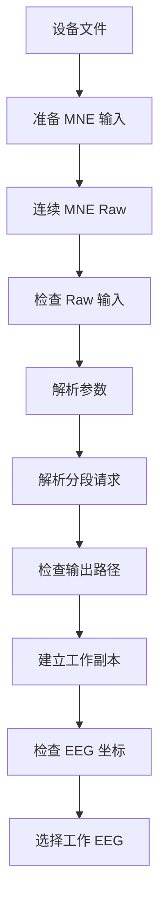

数据准备由独立脚本完成。输入携带经过校准的 SI 单位、通道类型、电极位置、时间、注释和事件；辅助通道样本保留在原 MNE 容器中。

### 2. 工频与坏导处理

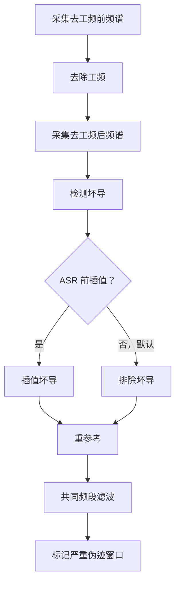

坏导检测使用临时训练频段信号。严重伪迹掩码在 ASR 前测量，供 ICA 训练排除使用。

### 3. ASR 与频段准备

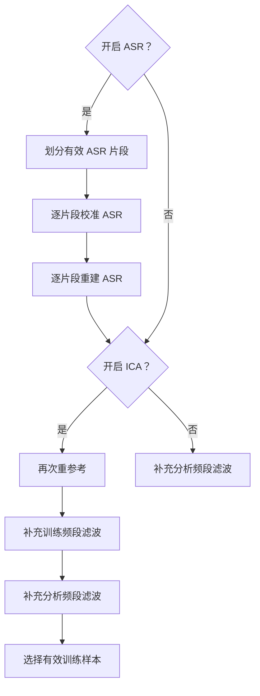

开启 ICA 后进入阶段 4；关闭 ICA 后直接进入阶段 6。频段准备仅补充所需的额外滤波边界；分析和训练频段相同时复用全程缓冲。

### 4. ICA 分解与自动建议

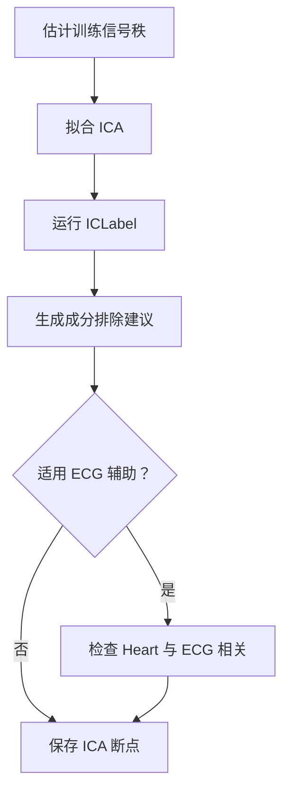

ECG 辅助适用于 `threshold` 规则下存在可用 ECG 的 Heart 单独达标候选。其参考信号在拟合 ICA 前，按相同有效训练样本准备。无可用 ECG 时仅由 ICLabel 决定自动建议。断点保存未经成分减除的分析频段数据及冻结分解模型。

### 5. 成分选择

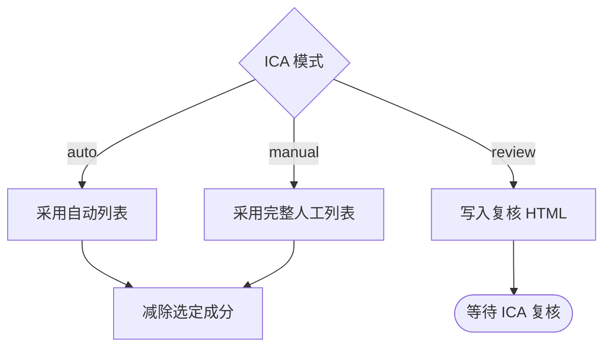

自动和人工模式进入阶段 6。复核模式返回 `awaiting_ica_review`，且 `result.raw` 为 `None`；随后使用下方续处理流程。

### 6. 连续数据交付

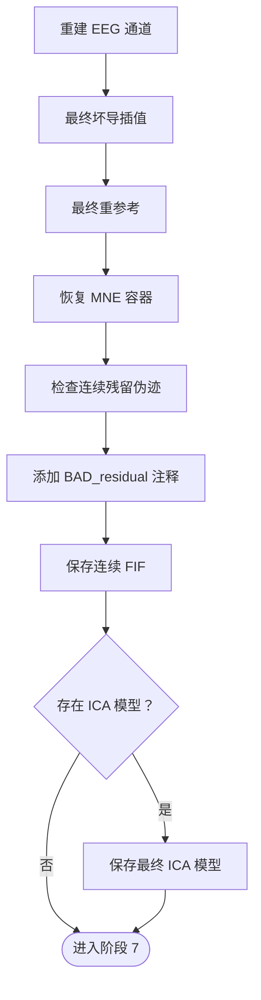

插值、参考和残留注释分别遵循对应开关。重建保留原辅助通道及 MNE 元数据；连续质控不删除采样点。

### 7. 可选分段与报告

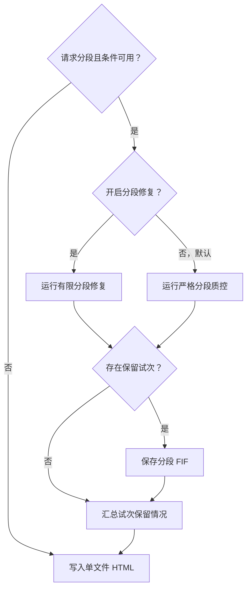

当 `epoch_qc="auto"` 时，事件分段使用真实事件窗质控，固定分段使用连续注释拒绝。有限修复是另一条分段路径。两者均保留输入 BAD；报告包括各条件保留情况及拒绝原因。

- 默认共同频段为：**静息态 0.5–100 Hz，ERP 0.1–100 Hz**。去工频位于这次滤波和 ASR 之前，不是只处理最终低通信号。
- 若分析与 ICA 训练频段完全相同，例如均为 **1–100 Hz**，则复用全程频段缓冲；选择有效训练样本和数值计算仍可能需要其他数组。
- ASR 不跨输入 BAD/边界校准或传播状态。短于配置最小长度的片段跳过并记录；`asr_cutoff=None` 可跳过 ASR。
- 每个可处理 ASR 片段独立选择参考数据、校准和重建，默认最小片段为 20 秒。严重伪迹掩码供后面的 ICA 训练排除使用，不是 ASR 额外排除掩码。
- 坏导检测使用剔除输入 BAD/边界后的临时训练频段副本。ICA 训练默认只保留至少 1 秒的有效子段，总有效量至少 20 秒；有限诊断预览只保留在内存，不另存 Raw 文件。
- 可选 `interpolate_before_asr=True` 会改变前段坏导处理方式。参考/插值开关仍生效；`reference="unchanged"` 也会使最终阶段不改变参考。
- 默认 `threshold` 规则下，仅因 Heart 达标的候选在存在可用 ECG 时还需满足 ECG 相关门槛；没有可用 ECG 时单用 ICLabel。`class_max` 按原脚本类别规则执行，不启用 ECG 辅助。
- 事件窗质控保留输入的全部 BAD，包括人工标记及原本已有的 `BAD_residual`；只对本次新增 `BAD_residual` 的重叠情况改查真实试次。连续输出保留这些注释。可选有限局部修复只改变 epochs。

默认质控策略尽量完成可执行处理，再报告问题供人工接受或排除。仅指定 `purpose="erp"` 不会自动请求分段；可选事件缺失时可能跳过分段，但连续处理仍可完成。

## ICA 人工复核与续处理

### 复核成分选择

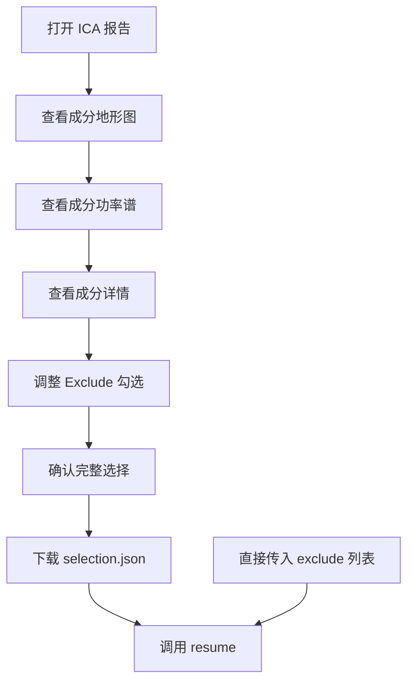

初次减除前或自动/人工运行后，均可使用复核 HTML。每张成分卡片和详情内都可调整 Exclude。下载的 JSON 与 `exclude=[...]` 是两种替代输入；编号从 0 开始，`exclude=[]` 表示保留全部成分。

### 从断点续处理

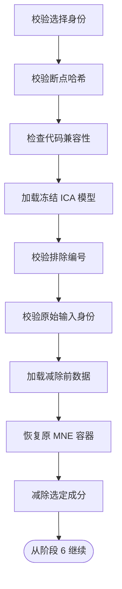

提供准备后的原始 FIF 或未改变的原始 Raw。兼容性检查包括计算源码及依赖。续处理使用独立输出目录。新列表替代之前的决定，先前删除、但未列入新列表的成分会恢复。

续处理复用原滤波、ASR、ICA 拟合和 ICLabel 结果，并复用父断点，不再复制一份完整断点。仅在 HTML 修改勾选不会改写 FIF；原报告红字和波形仍描述保存时的结果，需创建新一轮结果后才更新。

## 输入与交付文件

### 结果文件

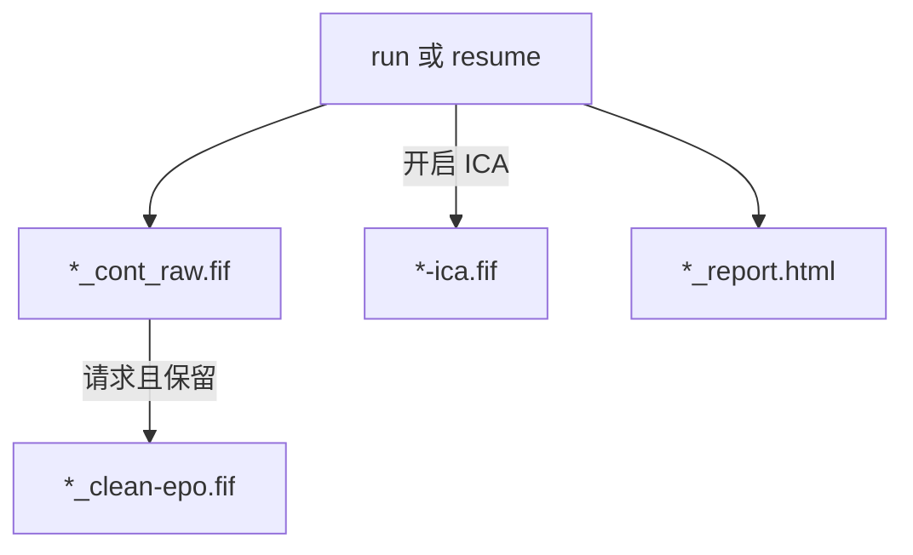

连续 FIF 包含清理后的 EEG 及原辅助通道。最终 ICA 模型包括已应用的排除列表。HTML 内嵌全部报告图片、表格、实际参数及来源记录。

### ICA 断点文件

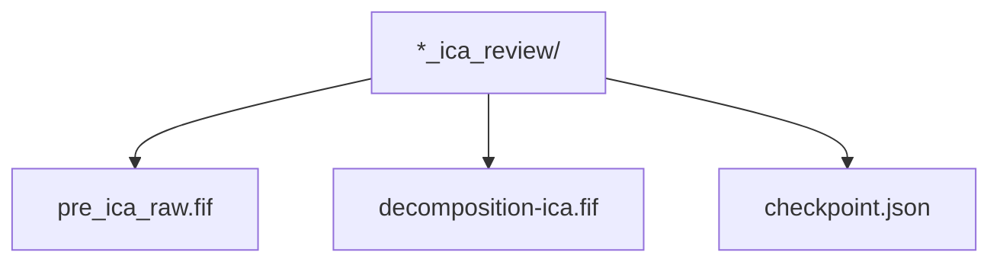

`pre_ica_raw.fif` 保存 IC 减除前的分析频段信号。`decomposition-ica.fif` 是冻结模型；`checkpoint.json` 记录续处理设置、身份校验及报告数据。

正常完成且启用 ICA 时通常为**六个文件**：三个结果文件加三个断点文件。保留 epochs 时再加一个。只运行 review 时输出 HTML 和断点；关闭 ICA 时没有模型及断点。大 FIF 可能拆成编号分卷。不生成 `original_raw.fif`、`preview_raw.fif`、逐阶段快照或报告图片/表格附件。`selection.json` 由复核者在需要时手动下载。
